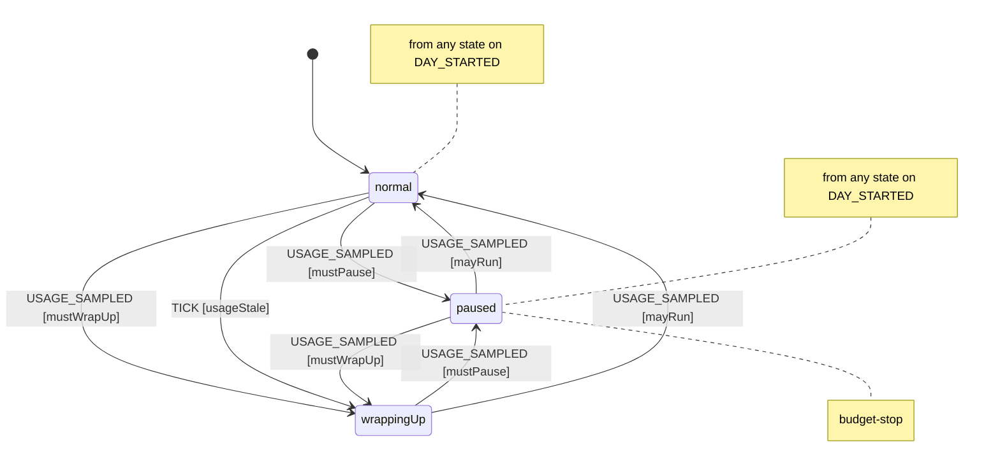
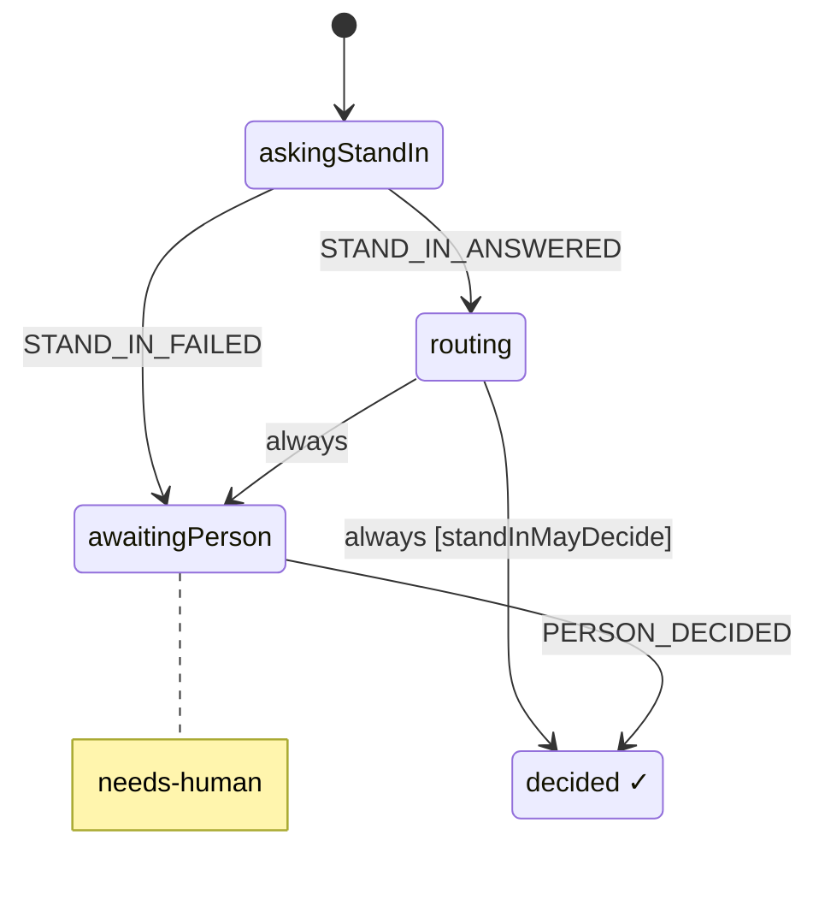
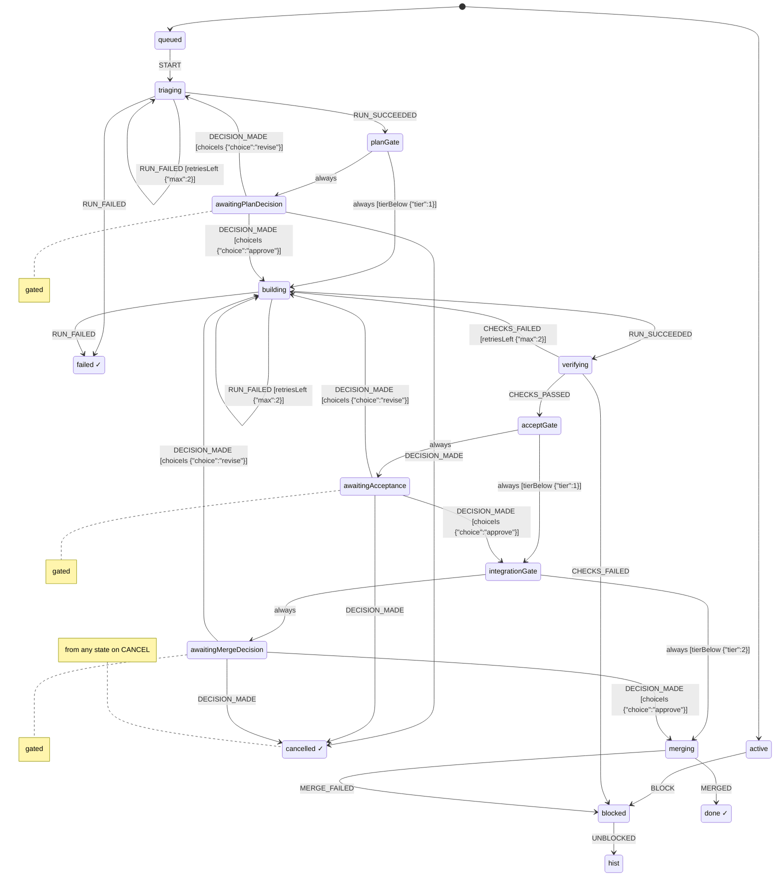
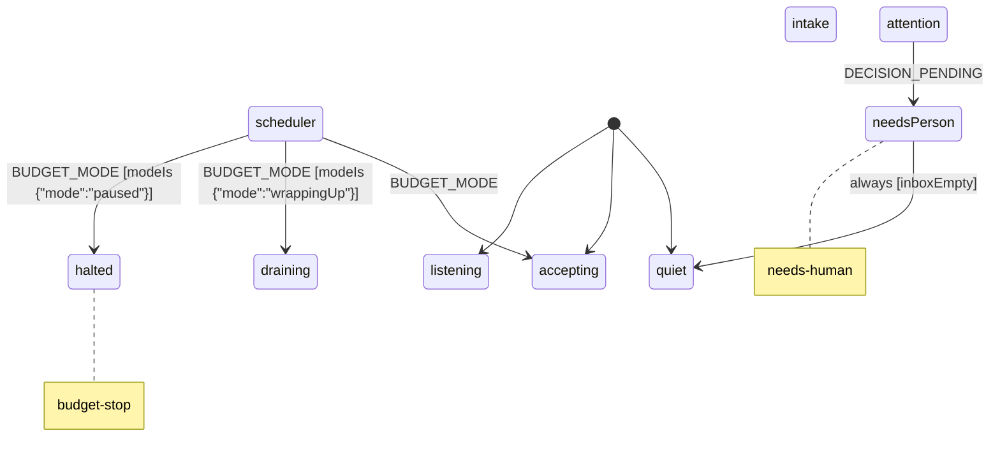

# Harness spec (generated)

Generated from `packages/harness/spec/*.machine.json` by `npm run spec:render`. Do not edit by hand: change the JSON.

## budget (v0.1.0)

Spends a daily slice of the person's 7-day Claude usage window and watches the 5-hour window. Utilization values are 0..1 shares of each window. Today's spend (spentToday) accumulates per sample; when the 7-day window resets mid-day (sevenDayResetsAt changes or utilization drops) it counts on from 0. A TICK judges an old reading by the work done since, not by its age alone: with no reading, or one older than backstopMs (24h), it drains a normal budget to wrappingUp. A TICK that carries costSince (the dollars of ledger turns filed since the newest reading) projects today's spend as spentToday + costSince x costRate (7-day share per dollar, conservative by default) and drains only when that reaches the soft limit, so an idle harness keeps accepting on an old reading. A TICK without costSince keeps the plain age rule (staleAfterMs). A fresh reading lifts it.

States:

- `normal`: Work may start.
- `wrappingUp`: Soft limit reached: start nothing new, bring work in flight to a checkpoint.
- `paused` (tags: `budget-stop`): Daily allowance spent or the 5-hour window nearly full: no turns except to save state.

Effects and context updates: `applyConfig`, `recordUsage`, `reportMode`, `startDay`

Guards: `fiveHourExhausted`, `mayRun`, `mustPause`, `mustWrapUp`, `usageStale`

## decision (v0.1.0)

One decision. The stand-in answers first; it decides alone only where its autonomy for this decision class is earned, otherwise the person decides on a card with its recommendation. Only a person's tap decides for the person: the machine checks that PERSON_DECIDED says actor person and source tap with the card's message id; that the tap is real is checked afterwards against the platform.

States:

- `awaitingPerson` (tags: `needs-human`): A decision card is in front of the person, with the stand-in's recommendation.

Refused (nothing changes and nothing is written):

- `PERSON_DECIDED` in `awaitingPerson`, when `unattested` {"actor":"person","source":"tap"}: Refused unless the actor is a person and the source a tap whose ref is the decision card's message id. The machine checks the kinds and that the id is there; whether the tap happened is checked afterwards against the platform.

Effects and context updates: `acceptStandInChoice`, `askStandIn`, `logPrecedent`, `notifyInboxClosed`, `notifyInboxOpened`, `postDecisionCard`, `recordPersonChoice`, `recordStandInAnswer`, `reportDecision`

Guards: `standInMayDecide`, `unattested`

## workItem (v0.1.0)

One thing moving through the pipeline: a change to one project of the monorepo, from request to merge. Runs and merges happen outside the machine; their results come back as events on later wakes. Run results come from a worker other than the orchestrator, whose id the harness passes in (orchestrator); CI and merge results come only from GitHub wakes, which from-github applies only after GitHub's REST API agrees. The machine checks actor and source kinds, that a ref is there, and that ids differ; who the sessions are is checked afterwards against the platform.

States:

- `active.queued`: Waiting for the scheduler to give it a slot.
- `active.triaging`: Scope, project, and acceptance criteria in the person's words.
- `active.awaitingPlanDecision` (tags: `gated`)
- `active.building`: A worker thread builds on its own branch and opens a PR.
- `active.verifying`: CI, spec checks and a reviewer run against the acceptance criteria.
- `active.awaitingAcceptance` (tags: `gated`): Evidence against each acceptance criterion: is the work doing what the person expected?
- `active.awaitingMergeDecision` (tags: `gated`): Merge to main: the person decides, the stand-in recommends.
- `blocked`: Waiting on something outside the item (a dependency, a conflict, a failing check). Resumes where it stopped.

Refused (nothing changes and nothing is written):

- `ORCHESTRATOR_STARTED` in any state, when `fromOutside`: Sent by the harness when an orchestrator starts inside the harness; the same event from outside (any event with an actor) is refused.
- `RUN_SUCCEEDED` in `active.triaging`, when `reportedByOrchestrator`: Refused when the orchestrator reports the run itself, or no orchestrator is known yet: a run result comes from a worker, an actor other than the orchestrator. The machine compares the ids it is given; that the worker really ran is checked afterwards.
- `RUN_FAILED` in `active.triaging`, when `reportedByOrchestrator`: Refused when the orchestrator reports the run itself, or no orchestrator is known yet: a run result comes from a worker, an actor other than the orchestrator. The machine compares the ids it is given; that the worker really ran is checked afterwards.
- `DECISION_MADE` in `active.awaitingPlanDecision`, when `fromOutside`: Sent by the item's own decision when it is decided inside the harness; the same event from outside (any event with an actor) is refused.
- `RUN_SUCCEEDED` in `active.building`, when `reportedByOrchestrator`: Refused when the orchestrator reports the run itself, or no orchestrator is known yet: a run result comes from a worker, an actor other than the orchestrator. The machine compares the ids it is given; that the worker really ran is checked afterwards.
- `RUN_FAILED` in `active.building`, when `reportedByOrchestrator`: Refused when the orchestrator reports the run itself, or no orchestrator is known yet: a run result comes from a worker, an actor other than the orchestrator. The machine compares the ids it is given; that the worker really ran is checked afterwards.
- `CHECKS_PASSED` in `active.verifying`, when `unattested` {"actor":"github","source":"github-wake"}: Refused unless a CI result comes from GitHub: actor github, source github-wake, with the GitHub fact as ref. The machine checks the kinds and that a ref is there; harness from-github sends it only after reading the PR from GitHub's REST API and finding the same result, which the ref names.
- `CHECKS_FAILED` in `active.verifying`, when `unattested` {"actor":"github","source":"github-wake"}: Refused unless a CI result comes from GitHub: actor github, source github-wake, with the GitHub fact as ref. The machine checks the kinds and that a ref is there; harness from-github sends it only after reading the PR from GitHub's REST API and finding the same result, which the ref names.
- `DECISION_MADE` in `active.awaitingAcceptance`, when `fromOutside`: Sent by the item's own decision when it is decided inside the harness; the same event from outside (any event with an actor) is refused.
- `DECISION_MADE` in `active.awaitingMergeDecision`, when `fromOutside`: Sent by the item's own decision when it is decided inside the harness; the same event from outside (any event with an actor) is refused.
- `MERGED` in `active.merging`, when `unattested` {"actor":"github","source":"github-wake"}: Refused unless a merge comes from GitHub: actor github, source github-wake, with the GitHub fact as ref. The machine checks the kinds and that a ref is there; harness from-github sends it only after reading the PR from GitHub's REST API and finding the same result, which the ref names.

Effects and context updates: `checkpoint`, `countRetry`, `dispatchRun`, `mergePullRequest`, `openDecision`, `recordChoice`, `recordOrchestrator`, `recordRun`, `reportBlocked`, `reportFinished`, `withdrawDecision`

Guards: `choiceIs`, `fromOutside`, `reportedByOrchestrator`, `retriesLeft`, `tierBelow`, `unattested`

## harness (v0.1.0)

The root actor, held by the orchestrator thread. Takes requests, keeps 2-4 items in flight within budget, and keeps the person's inbox. The orchestrator is the session that sent ORCHESTRATOR_STARTED last; items take its id from here.

States:

- `scheduler.accepting`: Start ready items while fewer than wipLimit are in flight.
- `scheduler.draining`: Soft budget limit: nothing new starts; items in flight are told to wrap up.
- `scheduler.halted` (tags: `budget-stop`): Budget stop: nothing runs until usage allows.
- `attention.quiet`: Nothing needs the person.
- `attention.needsPerson` (tags: `needs-human`)

Refused (nothing changes and nothing is written):

- `ORCHESTRATOR_STARTED` in any state, when `unattested` {"actor":"session"}: Refused unless the actor is a session. Its id becomes the orchestrator's, here and in every queued or in-flight item, so no run it reports itself is taken.
- `BUDGET_MODE` in `scheduler`, when `fromOutside`: Sent by the budget actor when its mode changes inside the harness; the same event from outside (any event with an actor) is refused.

Effects and context updates: `addToInbox`, `publishDigest`, `recordBudgetMode`, `recordOrchestrator`, `releaseSlot`, `removeFromInbox`, `spawnWorkItem`, `startReadyItems`, `wrapUpInFlight`

Guards: `fromOutside`, `inboxEmpty`, `modeIs`, `unattested`
