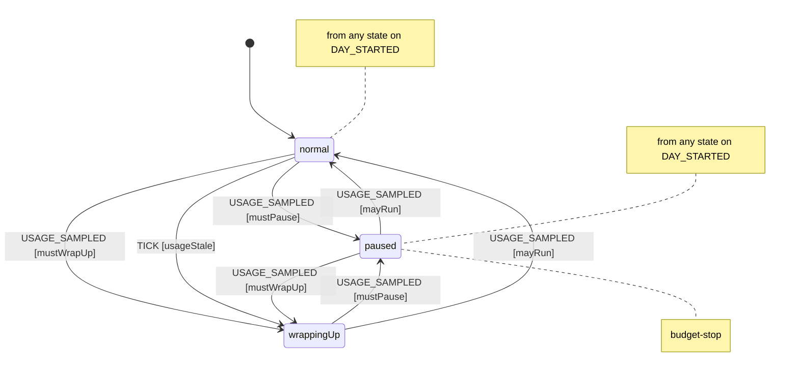
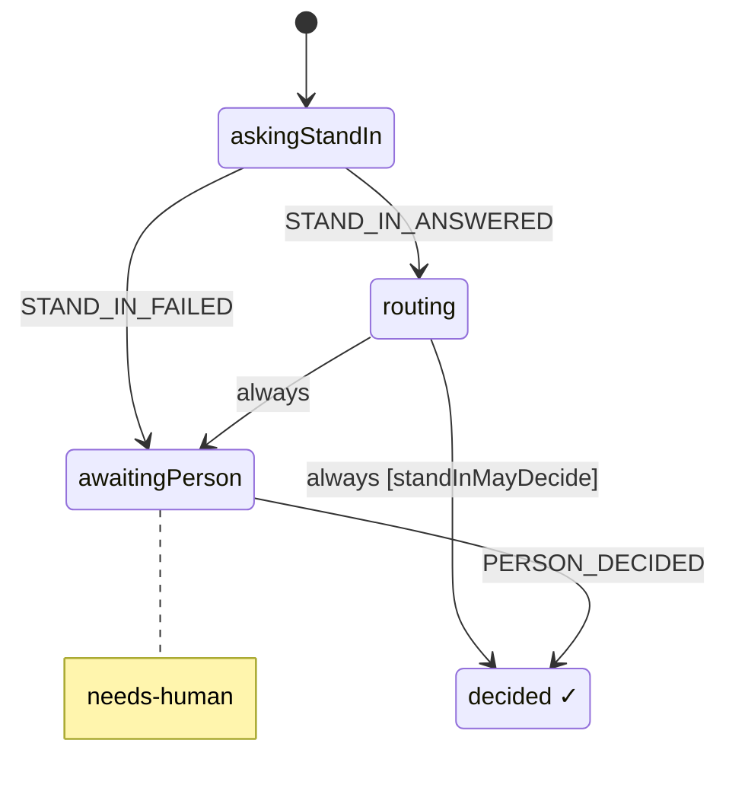
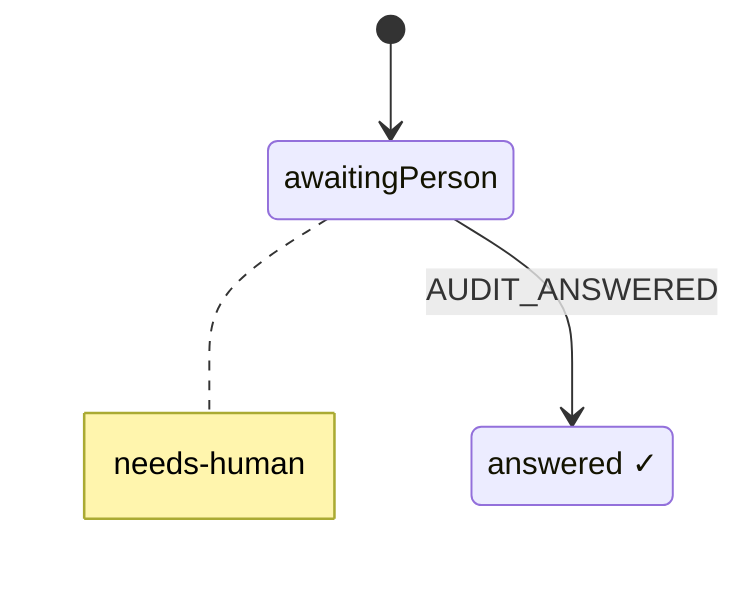
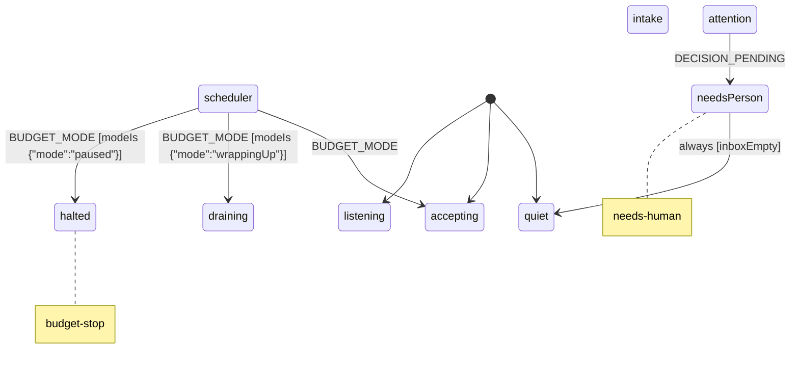

# Harness spec (generated)

Generated from `packages/harness/spec/*.machine.json` by `npm run spec:render`. Do not edit by hand: change the JSON.

## budget (v0.1.0)

Spends a daily slice of the person's 7-day Claude usage window and watches the 5-hour window. Utilization values are 0..1 shares of each window. Today's spend (spentToday) accumulates per sample; when the 7-day window resets mid-day (sevenDayResetsAt changes or utilization drops) it counts on from 0. A TICK judges an old reading by the work done since, not by its age alone: with no reading, or one older than backstopMs (24h), it drains a normal budget to wrappingUp. A TICK that carries costSince (the dollars of ledger turns filed since the newest reading) projects today's spend as spentToday + costSince x costRate (7-day share per dollar, conservative by default) and drains only when that reaches the soft limit, so an idle harness keeps accepting on an old reading. A TICK without costSince keeps the plain age rule (staleAfterMs). A fresh reading lifts it.

States:

- `normal`: Work may start.
- `wrappingUp`: Soft limit reached: start nothing new, bring work in flight to a checkpoint.
- `paused` (tags: `budget-stop`): Daily allowance spent or the 5-hour window nearly full: no turns except to save state.

Effects and context updates: `applyConfig`, `recordUsage`, `reportMode`, `startDay`

Guards: `fiveHourExhausted`, `mayRun`, `mustPause`, `mustWrapUp`, `usageStale`

## decision (v0.1.0)

One decision. The stand-in answers first; it decides alone only where its autonomy for this decision class is earned, otherwise the person decides on a card with its recommendation. Each input of standInMayDecide has one supplier, and none of them is the stand-in's caller: tier is the item's, set by triage (TRIAGED), never by the request; expectationsMet is the item's, from its acceptGate, for an accept decision; autonomy is the ladder's rung for the class over the store's own decided decisions (its logPrecedent effects and the AUDIT_ANSWERED events dated at or before the spawn; no file kept by hand), which the harness reads when it spawns the decision (recommend if they cannot be read, so the person decides); threshold is the constant in this machine's context; confidence is the stand-in's, the only number its answer carries. Only a person's tap decides for the person, and only on the card the machine asked for: postDecisionCard asks the host to post the card (its detail carries the decision's item and address, item:<item>/<id>, where the ack and the tap go), the host's ack of that effect names the card's message id (CARD_POSTED, which the decision records once), and PERSON_DECIDED is taken only from the person with source tap:<that id> and a choice among the card's options. A tap on no card, an unposted card or another decision's card is refused; that the tap is real is checked afterwards against the platform (harness verify-taps, by another session, which names the session that relayed each tap: relayedBy on the log row). The item passes in its roles when it opens the decision (requester, triagers, workers, checkers, answerers; spec workItem, Roles), and a stand-in answer from a session holding another of them is refused; the answering session is reported to the item (STAND_IN_RECORDED), which records it as an answerer.

States:

- `routing`: The stand-in decides alone when the tier is below 2, the class's autonomy (set at spawn from the ladder) is act, its confidence is at or above the machine's threshold, and, for an accept decision, the item's expectationsMet was true when the decision opened (false or unknown is not); otherwise the person decides.
- `awaitingPerson` (tags: `needs-human`): A decision card is in front of the person, with the stand-in's recommendation. The card is the one the machine asked for (postDecisionCard); its message id arrives with the ack (CARD_POSTED), and only a tap on it decides.

Refused (nothing changes and nothing is written):

- `STAND_IN_ANSWERED` in `askingStandIn`, when `unattested` {"actor":["session","agent"]}: Refused unless a session or an agent sends it: the stand-in is a session or a subagent of one (harness meta.actors).
- `STAND_IN_ANSWERED` in `askingStandIn`, when `answeredByOrchestratorOrWorker`: Refused from the orchestrator and from every worker that reported a run for this item (both recorded on the decision when it is spawned): only the stand-in answers, never the party whose work it judges or the one that routes it. The machine compares the ids it is given; who the sessions are is checked afterwards.
- `STAND_IN_ANSWERED` in `askingStandIn`, when `holdsAnotherRole` {"role":"answerer"}: Refused when the sender, a session or an agent (harness meta.actors), already holds another role on the item (requester, triager, worker or criterion checker; the item passes them in when it opens the decision): the stand-in that answers played no other part. The person and GitHub are exempt. The machine compares the whole actor; harness verify-actors checks sessions against the platform's ledger and agents against the SubagentStart records.
- `STAND_IN_ANSWERED` in `askingStandIn`, when `answerOverreaches`: Refused unless the answer is exactly a choice, a confidence between 0 and 1, and optionally a reason. An answer that carries autonomy or threshold is refused: the machine holds both. A missing confidence is refused; there is no default.
- `CARD_POSTED` in `awaitingPerson`, when `unattested` {"actor":"session"}: Refused unless a session sends it: the host session that posted the card acks the postDecisionCard effect with the card's message id (harness ack <effect> --card <cmsg id>, the only way to name it). A second ack of the effect is refused and writes nothing.
- `CARD_POSTED` in `awaitingPerson`, when `cardOverreaches`: Refused unless it names one message id (cmsg_...) and this decision has no card yet: one decision, one card, recorded once.
- `PERSON_DECIDED` in `awaitingPerson`, when `unattested` {"actor":"person","source":"tap"}: Refused unless the actor is a person and the source a tap.
- `PERSON_DECIDED` in `awaitingPerson`, when `tapUnbound`: Refused unless the tap's ref is this decision's card: the message id CARD_POSTED recorded when the host acked this decision's postDecisionCard effect. A tap before the card is posted, on another decision's card or on no card at all changes nothing. Whether the tap happened is checked afterwards against the platform (harness verify-taps).
- `PERSON_DECIDED` in `awaitingPerson`, when `choiceNotOffered`: Refused unless the choice is one of the card's options (the decision's options: approve, revise, reject).

Effects and context updates: `acceptStandInChoice`, `askStandIn`, `logPrecedent`, `notifyInboxClosed`, `notifyInboxOpened`, `postDecisionCard`, `recordCard`, `recordPersonChoice`, `recordStandInAnswer`, `reportAnswerer`, `reportDecision`

Guards: `answerOverreaches`, `answeredByOrchestratorOrWorker`, `cardOverreaches`, `choiceNotOffered`, `holdsAnotherRole`, `standInMayDecide`, `tapUnbound`, `unattested`

## audit (v0.1.0)

The day's stand-in audit. A class nobody checks never moves its ladder, so once a day the harness picks up to 3 decisions the stand-in made alone (AUDIT_PICKED, sent to the harness by the session that read the decision log; the picks are logPrecedent effect ids, which the decision log resolves from the store's own outbox and ignores when they name no stand-in decision). The audit asks the host to post one card (postAuditCard): option 0 confirms every pick, option i reverses pick i. The host's ack of that effect names the card's message id (CARD_POSTED), and the answer is AUDIT_ANSWERED from the person, by a tap on that card, exactly as a decision's PERSON_DECIDED. The decision log and the ladder read the answer from the event log (one person's decision per pick, dated when the person answered); no file in the store is read for a rung.

States:

- `awaitingPerson` (tags: `needs-human`): The audit card is in front of the person. Its message id arrives with the ack of postAuditCard (CARD_POSTED), and only a tap on it answers.
- `answered`: The person answered. The event log holds the answer; the decision log turns it into one person's decision per pick.

Refused (nothing changes and nothing is written):

- `CARD_POSTED` in `awaitingPerson`, when `unattested` {"actor":"session"}: Refused unless a session sends it: the host session that posted the card acks the postAuditCard effect with the card's message id (harness ack <effect> --card <cmsg id>).
- `CARD_POSTED` in `awaitingPerson`, when `cardOverreaches`: Refused unless it names one message id (cmsg_...) and this audit has no card yet.
- `AUDIT_ANSWERED` in `awaitingPerson`, when `unattested` {"actor":"person","source":"tap"}: Refused unless the actor is a person and the source a tap.
- `AUDIT_ANSWERED` in `awaitingPerson`, when `tapUnbound`: Refused unless the tap's ref is this audit's card, the message id CARD_POSTED recorded on the ack of its postAuditCard effect. A tap on no card, an unposted card or another card changes nothing.
- `AUDIT_ANSWERED` in `awaitingPerson`, when `optionNotOffered`: Refused unless the option is one of the card's: 0 (all right) or i, 1 to the number of picks (reverse pick i).

Effects and context updates: `postAuditCard`, `recordAuditAnswer`, `recordCard`

Guards: `cardOverreaches`, `optionNotOffered`, `tapUnbound`, `unattested`

## workItem (v0.1.0)

One thing moving through the pipeline: a change to one project of the monorepo, from request to merge. Runs and merges happen outside the machine; their results come back as events on later wakes. The request names the work (id, project, title, what the person expects in their own words) and nothing the machine holds: tier and criteria come from TRIAGED, sent by a triager who is not the requester, the orchestrator or a worker, and nothing leaves triage before it. Run results come from a worker other than the orchestrator, whose id the harness passes in (orchestrator); every worker that reports a run, succeeded or failed, is recorded (workers), and both ids go to every decision the item opens, so neither can answer as the stand-in. Each criterion is checked by CRITERION_CHECKED from an actor who is neither the orchestrator nor a worker; the stand-in may approve accept only when expectationsMet holds, and a new build clears the checks. A tier, once triage sets it, never goes down: a re-triage after a revise may keep or raise it. Tier 0 still has no plan or accept gate. That is acceptable for now because the tier comes from triage, not from the filer. CI and merge results come only from GitHub wakes, which from-github applies only after GitHub's REST API agrees. The machine checks actor and source kinds, that a ref is there, and that ids differ; who the sessions are is checked afterwards against the platform.

Roles: the item records who played each part, by actor: its requester (REQUEST_RECEIVED), triagers (TRIAGED), workers (RUN_SUCCEEDED, RUN_FAILED), criterion checkers (CRITERION_CHECKED) and stand-in answerers (STAND_IN_ANSWERED on any of its decisions, which the decision reports up as STAND_IN_RECORDED). One actor plays one part on an item: an event whose actor already holds a different role there is refused (holdsAnotherRole), so the triager cannot build, check or answer, a worker cannot triage, check or answer, a checker cannot build or answer, and the stand-in cannot triage, build or check. Each decision the item opens takes the roles as they stand. Roles are held by the worker actors, sessions and agents (harness meta.actors), compared by the whole actor: a subagent is agent <session_id>/<agent_id>, so two subagents of one session are distinct from each other and from their parent session, and the lead's triager, builder and checker subagents can play different parts. The person and GitHub are exempt: they are never recorded or compared. A session id is the platform's: the CLI takes CLAUDE_CODE_SESSION_ID and refuses an --actor session:<id> that differs; for a subagent it takes the agent from the plugin's PreToolUse hook (HARNESS_AGENT) and refuses any --actor session or other agent. harness verify-actors checks every session in the log against the Stop hook's ledger and every agent against the SubagentStart hook's record.

Workers: the lead spawns its builder, verifier and triager subagents through the plugin's spawn gate, and each spawn is an event on the item (WORKER_SPAWNED, sent by the spawning session) recording the role, the sha256 of the brief, the agent type, the model, the agent definition and the harness version; the plugin's SubagentStart hook binds the new agent to it (WORKER_STARTED), and the agent actor (#33) is recorded on the spawn. A triager is taken while the item is triaging, a builder while it is building, a verifier once it is built. Before any builder is spawned the verifier's brief is fixed by its hash (VERIFIER_BRIEF_FIXED, once), so it cannot be written after reading the builder's report: a builder spawn is refused until then, and a verifier spawn whose brief hash differs from the fixed one is refused. An agent sends a triage, a run result, a criterion check or a verdict for an item only when it is bound to a spawn of that item with the matching role, so an agent spawned with no role sends none. The verifier's verdict is VERDICT_GIVEN (PASS or FAIL for one head sha, the text posted verbatim as a COMMENT review on that sha, ending with the verifier brief's sha256), and MERGED is taken only for a head whose latest verdict is PASS. The host's own checks around these (the call record behind an agent actor, the role line of a brief, the store being reachable, the merge pinning its head and the review being on GitHub) are named in harness meta.invariants.

States:

- `active.queued`: Waiting for the scheduler to give it a slot.
- `active.triaging`: Scope, project, tier and acceptance criteria. The triage run's result is TRIAGED {tier, criteria}, from the triager; the item leaves triage only on it. A revise at the plan gate comes back here, and the tier it already has is a floor: a later triage may raise it, never lower it. A triager's failed run is a worker's run like any other.
- `active.needsCriteria` (tags: `needs-human`): Triage gave no criteria, so nothing could ever show the work is done: the item waits for the person and nothing proceeds from here. Missing criteria never count as met. It is in the person's inbox while it is here (counted and listed with the decisions that wait on the person), and it gives up its work-in-progress slot on entry (ITEM_PARKED), so other work starts while it waits. BLOCK and UNBLOCKED bring it back here, never to building. The way out is to cancel it; a new request with what done looks like starts again.
- `active.awaitingPlanDecision` (tags: `gated`)
- `active.building`: A worker thread builds on its own branch and opens a PR. Every build starts with no criterion checked: a check of an earlier build is not evidence for this one.
- `active.verifying`: CI, spec checks and a reviewer run against the acceptance criteria. The reviewer sends one CRITERION_CHECKED {criterion, verdict, evidence} per criterion; the latest verdict for a criterion counts.
- `active.acceptGate`: expectationsMet is true only when every criterion's latest CRITERION_CHECKED says met, with evidence, from an actor who is neither the orchestrator nor one of the item's workers now. Unmet, unclear, unchecked or no criteria are not met. The accept decision opens with the answer, and when it is false the stand-in cannot decide it, so the person does.
- `active.awaitingAcceptance` (tags: `gated`): Evidence against each acceptance criterion: is the work doing what the person expected? A criterion checked now takes the item back through acceptGate, which withdraws this decision and opens a new one with the new answer.
- `active.awaitingMergeDecision` (tags: `gated`): Merge to main: the person decides, the stand-in recommends.
- `blocked`: Waiting on something outside the item (a dependency, a conflict, a failing check). Resumes where it stopped.

Refused (nothing changes and nothing is written):

- `ORCHESTRATOR_STARTED` in any state, when `fromOutside`: Sent by the harness when an orchestrator starts inside the harness; the same event from outside (any event with an actor) is refused.
- `STAND_IN_RECORDED` in any state, when `fromOutside`: Sent by the item's own decision when the stand-in's answer is recorded, naming the answering session; the same event from outside (any event with an actor) is refused.
- `VERIFIER_BRIEF_FIXED` in `active`, when `unattested` {"actor":["session"]}: Refused unless a session sends it: the lead fixes the verifier's brief; a subagent cannot.
- `VERIFIER_BRIEF_FIXED` in `active`, when `briefOverreaches`: Refused unless sha256 is 64 lowercase hex characters and the item has no verifier brief yet: the hash is fixed once, so a later brief cannot replace it.
- `WORKER_STARTED` in `active`, when `unattested` {"actor":["session"]}: Refused unless a session sends it: the plugin's SubagentStart hook binds the agent as the session that spawned it.
- `WORKER_STARTED` in `active`, when `noSpawnToBind` {"withinMs":300000}: Refused unless agent is <session_id>/<agent_id> of the sending session, bound to no spawn of this item yet, and the sender recorded a spawn of agentType here that is unbound and at most withinMs old; the oldest such spawn is bound.
- `TRIAGED` in `active.triaging`, when `triagedByParty`: Refused from the requester's actor, the orchestrator (or while none is known), every worker on the item and an event with no actor: the tier and the criteria are not set by the party that asked for the work, routes it or does it. The machine compares the ids it is given; who the sessions are is checked afterwards.
- `TRIAGED` in `active.triaging`, when `unspawnedAgent` {"role":"triager"}: Refused from an agent that is not bound to a triager spawn of this item (WORKER_SPAWNED, then WORKER_STARTED from the SubagentStart hook): an agent spawned with no role, or for another role or item, cannot triage. Sessions are exempt; the spawn gate and the call record make an agent actor what the plugin's hooks saw.
- `TRIAGED` in `active.triaging`, when `holdsAnotherRole` {"role":"triager"}: Refused when the sender, a session or an agent (harness meta.actors), already holds another role on this item (requester, worker, criterion checker or stand-in answerer): the triager plays no other part. The person and GitHub are exempt. The machine compares the whole actor; harness verify-actors checks sessions against the platform's ledger and agents against the SubagentStart records.
- `TRIAGED` in `active.triaging`, when `triageOverreaches`: Refused unless tier is 0, 1 or 2, and criteria, when given, is a list of non-empty strings. A missing criteria list is no criteria.
- `TRIAGED` in `active.triaging`, when `tierLowered`: Refused when the item already has a tier and this TRIAGED gives a lower one (or none). A revise sends the plan back to triage, which runs again and may keep or raise the tier but never lower it, so a second triage cannot skip a gate the first one set. The guard reads the previous tier from context, which a revise keeps; an equal or higher tier is taken.
- `RUN_FAILED` in `active.triaging`, when `reportedByOrchestrator`: Refused when the orchestrator reports the run itself, or no orchestrator is known yet: a run result comes from a worker, an actor other than the orchestrator. The machine compares the ids it is given; that the worker really ran is checked afterwards.
- `RUN_FAILED` in `active.triaging`, when `unspawnedAgent` {"role":"triager"}: Refused from an agent that is not bound to a triager spawn of this item (WORKER_SPAWNED, then WORKER_STARTED from the SubagentStart hook): a triager's failed run comes from the item's triager agent. Sessions are exempt; the spawn gate and the call record make an agent actor what the plugin's hooks saw.
- `RUN_FAILED` in `active.triaging`, when `holdsAnotherRole` {"role":"worker"}: Refused when the sender, a session or an agent (harness meta.actors), already holds another role on this item (requester, triager, criterion checker or stand-in answerer): the triager, a checker or the stand-in cannot build. The person and GitHub are exempt. The machine compares the whole actor; harness verify-actors checks sessions against the platform's ledger and agents against the SubagentStart records.
- `WORKER_SPAWNED` in `active.triaging`, when `unattested` {"actor":["session"]}: Refused unless a session sends it: the lead spawns workers, and the plugin's spawn gate records the spawn as that session before the Agent call runs.
- `WORKER_SPAWNED` in `active.triaging`, when `spawnOverreaches`: Refused unless role is builder, verifier or triager, briefSha256 is the sha256 of the brief (64 lowercase hex), agentType is a non-empty string and model, when given, is a string.
- `WORKER_SPAWNED` in `active.triaging`, when `roleNotHere` {"roles":["triager"]}: Refused unless the role is triager: a triager is spawned while the item is triaging, a builder while it is building, a verifier once it is built.
- `WORKER_SPAWNED` in `active.triaging`, when `agentTypeIsNot` {"builder":"harness:builder","verifier":"harness:verifier"}: Refused when a builder or verifier is spawned with another agent type than the plugin's standing definition for the role (plugins/harness/agents), whose rules do not drift per brief.
- `DECISION_MADE` in `active.awaitingPlanDecision`, when `fromOutside`: Sent by the item's own decision when it is decided inside the harness; the same event from outside (any event with an actor) is refused.
- `RUN_SUCCEEDED` in `active.building`, when `reportedByOrchestrator`: Refused when the orchestrator reports the run itself, or no orchestrator is known yet: a run result comes from a worker, an actor other than the orchestrator. The machine compares the ids it is given; that the worker really ran is checked afterwards.
- `RUN_SUCCEEDED` in `active.building`, when `unspawnedAgent` {"role":"builder"}: Refused from an agent that is not bound to a builder spawn of this item (WORKER_SPAWNED, then WORKER_STARTED from the SubagentStart hook): an agent spawned with no role, or for another role or item, cannot report a run. Sessions are exempt; the spawn gate and the call record make an agent actor what the plugin's hooks saw.
- `RUN_SUCCEEDED` in `active.building`, when `holdsAnotherRole` {"role":"worker"}: Refused when the sender, a session or an agent (harness meta.actors), already holds another role on this item (requester, triager, criterion checker or stand-in answerer): the triager, a checker or the stand-in cannot build. The person and GitHub are exempt. The machine compares the whole actor; harness verify-actors checks sessions against the platform's ledger and agents against the SubagentStart records.
- `RUN_FAILED` in `active.building`, when `reportedByOrchestrator`: Refused when the orchestrator reports the run itself, or no orchestrator is known yet: a run result comes from a worker, an actor other than the orchestrator. The machine compares the ids it is given; that the worker really ran is checked afterwards.
- `RUN_FAILED` in `active.building`, when `unspawnedAgent` {"role":"builder"}: Refused from an agent that is not bound to a builder spawn of this item (WORKER_SPAWNED, then WORKER_STARTED from the SubagentStart hook): an agent spawned with no role, or for another role or item, cannot report a run. Sessions are exempt; the spawn gate and the call record make an agent actor what the plugin's hooks saw.
- `RUN_FAILED` in `active.building`, when `holdsAnotherRole` {"role":"worker"}: Refused when the sender, a session or an agent (harness meta.actors), already holds another role on this item (requester, triager, criterion checker or stand-in answerer): the triager, a checker or the stand-in cannot build. The person and GitHub are exempt. The machine compares the whole actor; harness verify-actors checks sessions against the platform's ledger and agents against the SubagentStart records.
- `WORKER_SPAWNED` in `active.building`, when `unattested` {"actor":["session"]}: Refused unless a session sends it: the lead spawns workers, and the plugin's spawn gate records the spawn as that session before the Agent call runs.
- `WORKER_SPAWNED` in `active.building`, when `spawnOverreaches`: Refused unless role is builder, verifier or triager, briefSha256 is the sha256 of the brief (64 lowercase hex), agentType is a non-empty string and model, when given, is a string.
- `WORKER_SPAWNED` in `active.building`, when `roleNotHere` {"roles":["builder"]}: Refused unless the role is builder: a triager is spawned while the item is triaging, a builder while it is building, a verifier once it is built.
- `WORKER_SPAWNED` in `active.building`, when `agentTypeIsNot` {"builder":"harness:builder","verifier":"harness:verifier"}: Refused when a builder or verifier is spawned with another agent type than the plugin's standing definition for the role (plugins/harness/agents), whose rules do not drift per brief.
- `WORKER_SPAWNED` in `active.building`, when `noVerifierBrief`: Refused while the item has no verifier brief hash (VERIFIER_BRIEF_FIXED): the verifier's brief is fixed before any builder is spawned, so it cannot be written after reading the builder's report.
- `CHECKS_PASSED` in `active.verifying`, when `unattested` {"actor":"github","source":"github-wake"}: Refused unless a CI result comes from GitHub: actor github, source github-wake, with the GitHub fact as ref. The machine checks the kinds and that a ref is there; harness from-github sends it only after reading the PR from GitHub's REST API and finding the same result, which the ref names.
- `CHECKS_FAILED` in `active.verifying`, when `unattested` {"actor":"github","source":"github-wake"}: Refused unless a CI result comes from GitHub: actor github, source github-wake, with the GitHub fact as ref. The machine checks the kinds and that a ref is there; harness from-github sends it only after reading the PR from GitHub's REST API and finding the same result, which the ref names.
- `CRITERION_CHECKED` in `active.verifying`, when `checkedByParty`: Refused from the orchestrator (or while none is known), every worker on the item and an event with no actor: a criterion is checked by someone who did not do or route the work. The machine compares the ids it is given; who the sessions are is checked afterwards.
- `CRITERION_CHECKED` in `active.verifying`, when `unspawnedAgent` {"role":"verifier"}: Refused from an agent that is not bound to a verifier spawn of this item (WORKER_SPAWNED, then WORKER_STARTED from the SubagentStart hook): an agent spawned with no role, or for another role or item, cannot check a criterion. Sessions are exempt; the spawn gate and the call record make an agent actor what the plugin's hooks saw.
- `CRITERION_CHECKED` in `active.verifying`, when `holdsAnotherRole` {"role":"checker"}: Refused when the sender, a session or an agent (harness meta.actors), already holds another role on this item (requester, triager, worker or stand-in answerer): the triager or the stand-in cannot check a criterion. The person and GitHub are exempt. The machine compares the whole actor; harness verify-actors checks sessions against the platform's ledger and agents against the SubagentStart records.
- `CRITERION_CHECKED` in `active.verifying`, when `checkOverreaches`: Refused unless criterion is one of the item's criteria, verdict is met, unmet or unclear, and a met verdict carries evidence (a non-empty string).
- `WORKER_SPAWNED` in `active.verifying`, when `unattested` {"actor":["session"]}: Refused unless a session sends it: the lead spawns workers, and the plugin's spawn gate records the spawn as that session before the Agent call runs.
- `WORKER_SPAWNED` in `active.verifying`, when `spawnOverreaches`: Refused unless role is builder, verifier or triager, briefSha256 is the sha256 of the brief (64 lowercase hex), agentType is a non-empty string and model, when given, is a string.
- `WORKER_SPAWNED` in `active.verifying`, when `roleNotHere` {"roles":["verifier"]}: Refused unless the role is verifier: a triager is spawned while the item is triaging, a builder while it is building, a verifier once it is built.
- `WORKER_SPAWNED` in `active.verifying`, when `agentTypeIsNot` {"builder":"harness:builder","verifier":"harness:verifier"}: Refused when a builder or verifier is spawned with another agent type than the plugin's standing definition for the role (plugins/harness/agents), whose rules do not drift per brief.
- `WORKER_SPAWNED` in `active.verifying`, when `briefDiffers`: Refused unless the brief's sha256 is the verifier brief hash fixed for the item: a verifier spawned with an edited brief, or before any was fixed, is not taken.
- `VERDICT_GIVEN` in `active.verifying`, when `unattested` {"actor":"agent"}: Refused unless an agent sends it: the verdict is the verifier subagent's, from its own agent actor (harness verdict).
- `VERDICT_GIVEN` in `active.verifying`, when `unspawnedAgent` {"role":"verifier"}: Refused from an agent that is not bound to a verifier spawn of this item (WORKER_SPAWNED, then WORKER_STARTED from the SubagentStart hook): only the verifier the item spawned gives its verdict. Sessions are exempt; the spawn gate and the call record make an agent actor what the plugin's hooks saw.
- `VERDICT_GIVEN` in `active.verifying`, when `verdictOverreaches`: Refused unless verdict is PASS or FAIL, sha is a full 40-character head sha, review is the id of the GitHub review that carries it, and text is the verdict as posted, ending with the item's verifier brief sha256.
- `DECISION_MADE` in `active.awaitingAcceptance`, when `fromOutside`: Sent by the item's own decision when it is decided inside the harness; the same event from outside (any event with an actor) is refused.
- `CRITERION_CHECKED` in `active.awaitingAcceptance`, when `checkedByParty`: Refused from the orchestrator (or while none is known), every worker on the item and an event with no actor: a criterion is checked by someone who did not do or route the work. The machine compares the ids it is given; who the sessions are is checked afterwards.
- `CRITERION_CHECKED` in `active.awaitingAcceptance`, when `unspawnedAgent` {"role":"verifier"}: Refused from an agent that is not bound to a verifier spawn of this item (WORKER_SPAWNED, then WORKER_STARTED from the SubagentStart hook): an agent spawned with no role, or for another role or item, cannot check a criterion. Sessions are exempt; the spawn gate and the call record make an agent actor what the plugin's hooks saw.
- `CRITERION_CHECKED` in `active.awaitingAcceptance`, when `holdsAnotherRole` {"role":"checker"}: Refused when the sender, a session or an agent (harness meta.actors), already holds another role on this item (requester, triager, worker or stand-in answerer): the triager or the stand-in cannot check a criterion. The person and GitHub are exempt. The machine compares the whole actor; harness verify-actors checks sessions against the platform's ledger and agents against the SubagentStart records.
- `CRITERION_CHECKED` in `active.awaitingAcceptance`, when `checkOverreaches`: Refused unless criterion is one of the item's criteria, verdict is met, unmet or unclear, and a met verdict carries evidence (a non-empty string).
- `WORKER_SPAWNED` in `active.awaitingAcceptance`, when `unattested` {"actor":["session"]}: Refused unless a session sends it: the lead spawns workers, and the plugin's spawn gate records the spawn as that session before the Agent call runs.
- `WORKER_SPAWNED` in `active.awaitingAcceptance`, when `spawnOverreaches`: Refused unless role is builder, verifier or triager, briefSha256 is the sha256 of the brief (64 lowercase hex), agentType is a non-empty string and model, when given, is a string.
- `WORKER_SPAWNED` in `active.awaitingAcceptance`, when `roleNotHere` {"roles":["verifier"]}: Refused unless the role is verifier: a triager is spawned while the item is triaging, a builder while it is building, a verifier once it is built.
- `WORKER_SPAWNED` in `active.awaitingAcceptance`, when `agentTypeIsNot` {"builder":"harness:builder","verifier":"harness:verifier"}: Refused when a builder or verifier is spawned with another agent type than the plugin's standing definition for the role (plugins/harness/agents), whose rules do not drift per brief.
- `WORKER_SPAWNED` in `active.awaitingAcceptance`, when `briefDiffers`: Refused unless the brief's sha256 is the verifier brief hash fixed for the item: a verifier spawned with an edited brief, or before any was fixed, is not taken.
- `VERDICT_GIVEN` in `active.awaitingAcceptance`, when `unattested` {"actor":"agent"}: Refused unless an agent sends it: the verdict is the verifier subagent's, from its own agent actor (harness verdict).
- `VERDICT_GIVEN` in `active.awaitingAcceptance`, when `unspawnedAgent` {"role":"verifier"}: Refused from an agent that is not bound to a verifier spawn of this item (WORKER_SPAWNED, then WORKER_STARTED from the SubagentStart hook): only the verifier the item spawned gives its verdict. Sessions are exempt; the spawn gate and the call record make an agent actor what the plugin's hooks saw.
- `VERDICT_GIVEN` in `active.awaitingAcceptance`, when `verdictOverreaches`: Refused unless verdict is PASS or FAIL, sha is a full 40-character head sha, review is the id of the GitHub review that carries it, and text is the verdict as posted, ending with the item's verifier brief sha256.
- `DECISION_MADE` in `active.awaitingMergeDecision`, when `fromOutside`: Sent by the item's own decision when it is decided inside the harness; the same event from outside (any event with an actor) is refused.
- `WORKER_SPAWNED` in `active.awaitingMergeDecision`, when `unattested` {"actor":["session"]}: Refused unless a session sends it: the lead spawns workers, and the plugin's spawn gate records the spawn as that session before the Agent call runs.
- `WORKER_SPAWNED` in `active.awaitingMergeDecision`, when `spawnOverreaches`: Refused unless role is builder, verifier or triager, briefSha256 is the sha256 of the brief (64 lowercase hex), agentType is a non-empty string and model, when given, is a string.
- `WORKER_SPAWNED` in `active.awaitingMergeDecision`, when `roleNotHere` {"roles":["verifier"]}: Refused unless the role is verifier: a triager is spawned while the item is triaging, a builder while it is building, a verifier once it is built.
- `WORKER_SPAWNED` in `active.awaitingMergeDecision`, when `agentTypeIsNot` {"builder":"harness:builder","verifier":"harness:verifier"}: Refused when a builder or verifier is spawned with another agent type than the plugin's standing definition for the role (plugins/harness/agents), whose rules do not drift per brief.
- `WORKER_SPAWNED` in `active.awaitingMergeDecision`, when `briefDiffers`: Refused unless the brief's sha256 is the verifier brief hash fixed for the item: a verifier spawned with an edited brief, or before any was fixed, is not taken.
- `VERDICT_GIVEN` in `active.awaitingMergeDecision`, when `unattested` {"actor":"agent"}: Refused unless an agent sends it: the verdict is the verifier subagent's, from its own agent actor (harness verdict).
- `VERDICT_GIVEN` in `active.awaitingMergeDecision`, when `unspawnedAgent` {"role":"verifier"}: Refused from an agent that is not bound to a verifier spawn of this item (WORKER_SPAWNED, then WORKER_STARTED from the SubagentStart hook): only the verifier the item spawned gives its verdict. Sessions are exempt; the spawn gate and the call record make an agent actor what the plugin's hooks saw.
- `VERDICT_GIVEN` in `active.awaitingMergeDecision`, when `verdictOverreaches`: Refused unless verdict is PASS or FAIL, sha is a full 40-character head sha, review is the id of the GitHub review that carries it, and text is the verdict as posted, ending with the item's verifier brief sha256.
- `MERGED` in `active.merging`, when `unattested` {"actor":"github","source":"github-wake"}: Refused unless a merge comes from GitHub: actor github, source github-wake, with the GitHub fact as ref. The machine checks the kinds and that a ref is there; harness from-github sends it only after reading the PR from GitHub's REST API and finding the same result, which the ref names.
- `MERGED` in `active.merging`, when `unverifiedHead`: Refused unless sha is the head merged and the item's latest verdict for that sha is the verifier's PASS: no verdict, a FAIL, or a PASS on an older head is not taken. The merge gate asks this before a merge call runs; harness doctor lists a merged PR without it.
- `WORKER_SPAWNED` in `active.merging`, when `unattested` {"actor":["session"]}: Refused unless a session sends it: the lead spawns workers, and the plugin's spawn gate records the spawn as that session before the Agent call runs.
- `WORKER_SPAWNED` in `active.merging`, when `spawnOverreaches`: Refused unless role is builder, verifier or triager, briefSha256 is the sha256 of the brief (64 lowercase hex), agentType is a non-empty string and model, when given, is a string.
- `WORKER_SPAWNED` in `active.merging`, when `roleNotHere` {"roles":["verifier"]}: Refused unless the role is verifier: a triager is spawned while the item is triaging, a builder while it is building, a verifier once it is built.
- `WORKER_SPAWNED` in `active.merging`, when `agentTypeIsNot` {"builder":"harness:builder","verifier":"harness:verifier"}: Refused when a builder or verifier is spawned with another agent type than the plugin's standing definition for the role (plugins/harness/agents), whose rules do not drift per brief.
- `WORKER_SPAWNED` in `active.merging`, when `briefDiffers`: Refused unless the brief's sha256 is the verifier brief hash fixed for the item: a verifier spawned with an edited brief, or before any was fixed, is not taken.
- `VERDICT_GIVEN` in `active.merging`, when `unattested` {"actor":"agent"}: Refused unless an agent sends it: the verdict is the verifier subagent's, from its own agent actor (harness verdict).
- `VERDICT_GIVEN` in `active.merging`, when `unspawnedAgent` {"role":"verifier"}: Refused from an agent that is not bound to a verifier spawn of this item (WORKER_SPAWNED, then WORKER_STARTED from the SubagentStart hook): only the verifier the item spawned gives its verdict. Sessions are exempt; the spawn gate and the call record make an agent actor what the plugin's hooks saw.
- `VERDICT_GIVEN` in `active.merging`, when `verdictOverreaches`: Refused unless verdict is PASS or FAIL, sha is a full 40-character head sha, review is the id of the GitHub review that carries it, and text is the verdict as posted, ending with the item's verifier brief sha256.

Effects and context updates: `bindSpawn`, `checkpoint`, `clearChecks`, `countRetry`, `dispatchRun`, `giveUpSlot`, `mergePullRequest`, `notifyInboxClosed`, `notifyInboxOpened`, `openDecision`, `recordAnswerer`, `recordCheck`, `recordChoice`, `recordExpectations`, `recordOrchestrator`, `recordRun`, `recordSpawn`, `recordTriage`, `recordVerdict`, `recordVerifierBrief`, `recordWorker`, `reportBlocked`, `reportFinished`, `withdrawDecision`

Guards: `agentTypeIsNot`, `briefDiffers`, `briefOverreaches`, `checkOverreaches`, `checkedByParty`, `choiceIs`, `expectationsMet`, `fromOutside`, `holdsAnotherRole`, `noCriteria`, `noSpawnToBind`, `noVerifierBrief`, `reportedByOrchestrator`, `retriesLeft`, `roleNotHere`, `spawnOverreaches`, `tierBelow`, `tierLowered`, `triageOverreaches`, `triagedByParty`, `unattested`, `unspawnedAgent`, `unverifiedHead`, `verdictOverreaches`

## harness (v0.1.0)

The root actor, held by the orchestrator thread. Takes requests, keeps 2-4 items in flight within budget, and keeps the person's inbox. The orchestrator is the session that sent ORCHESTRATOR_STARTED last; items take its id from here. It also opens the day's stand-in audit (AUDIT_PICKED), once per day, as a child audit actor (spec audit).

Actors:

- `person`: The person: acts only by a tap on a card the machine asked for, and holds no role.
- `session` (id `^[^/]+$`), holds roles: A Claude Code session (a thread): id CLAUDE_CODE_SESSION_ID, which the CLI takes from the platform. It never contains '/'.
- `agent` (id `^[^/]+/[^/]+$`), holds roles: A subagent of a session: id <session_id>/<agent_id>, the session's CLAUDE_CODE_SESSION_ID and the agent_id of the hook input, so it names both; type is its agent_type. The plugin's PreToolUse hook hands it to every harness call a subagent runs (HARNESS_AGENT=<agent_id>:<agent_type>) and the CLI records it as this actor; its SubagentStart hook files a record that harness verify-actors checks it against. Two subagents of one session are two actors, and neither is the session.
- `github`: GitHub: only through harness from-github, after its REST API agrees.
- `timer`: The harness's own clock (tick, digest, canary).

Actors marked roles (session and agent) are recorded in an item's roles and compared there by the whole actor, kind and id: the id patterns are disjoint, so the recorded id names one actor. An event whose actor is not one of these kinds, or whose id does not match its kind's pattern, is refused before any machine sees it.

Host invariants (refused or denied outside the machines; every such site in the code names one of these or a guard):

- `envelope`: runtime.apply refuses an event without an actor of a kind in meta.actors (its id of that form) and a source, or one carrying "person", before any machine sees it.
- `prBinding`: runtime.apply refuses an event naming a PR bound to another item, or naming another PR than its item is bound to: one PR binds to one item, once (src/pr-binding.js).
- `tapOnly`: runtime.apply refuses an event from a person or a tap unless its machine binds the tap to its card (the events guarded by tapUnbound).
- `setsHarnessAgent`: The plugin's PreToolUse hook denies a Bash command that sets, exports, clears or passes HARNESS_AGENT or HARNESS_CALL itself: only the hook sets them.
- `hookSawCall`: The CLI takes an agent actor (HARNESS_AGENT) only when the plugin's PreToolUse record for the call it runs in (HARNESS_CALL: session, agent_id, tool_use_id, command hash, time) names that session and agent; under HARNESS_ENFORCE=1 a call the hook did not record sends nothing.
- `roleLine`: The spawn gate reads a brief's role from one line 'Harness-Role: <role> item:<id>' naming an item in the store; under HARNESS_ENFORCE=1 a brief with a malformed or repeated role line, or a harness:builder or harness:verifier spawn without one, is denied.
- `storeReachable`: Under HARNESS_ENFORCE=1 the spawn and merge gates deny a call they must judge when the store or the harness CLI cannot be read.
- `mergeBound`: Under HARNESS_ENFORCE=1 the merge gate denies a merge of a PR it cannot name, or one bound to no item.
- `pinnedHead`: Under HARNESS_ENFORCE=1 the merge gate denies a merge call that does not pin the head sha (expectedHeadSha, --match-head-commit or sha).
- `reviewOnHead`: Under HARNESS_ENFORCE=1 the merge gate denies a merge unless the PR carries the item's PASS verdict, verbatim, as a review on the pinned head sha (commit_id), read from GitHub's REST API.

States:

- `scheduler`: Holds the WIP limit. WIP_SET from the orchestrator records a new wipLimit (the first one keeps init's as wipLimitAtInit, which replay starts from); outside accepting it starts nothing, and lowering it never stops an item in flight. An item that finishes, even one cancelled while still queued, leaves inFlight and queued, so no slot goes to it; and whenever items start, any id in inFlight or queued whose item has already finished is dropped (a store from before that rule), so a finished item never holds a slot.
- `scheduler.accepting`: Start ready items while fewer than wipLimit are in flight, and again at once when WIP_SET raises the limit.
- `scheduler.draining`: Soft budget limit: nothing new starts; items in flight are told to wrap up.
- `scheduler.halted` (tags: `budget-stop`): Budget stop: nothing runs until usage allows.
- `attention.quiet`: Nothing needs the person.
- `attention.needsPerson` (tags: `needs-human`): The person's inbox is not empty: it holds every open decision and every item waiting in needsCriteria, and each leaves it when it closes (DECISION_CLOSED).

Refused (nothing changes and nothing is written):

- `ORCHESTRATOR_STARTED` in any state, when `unattested` {"actor":"session"}: Refused unless the actor is a session. Its id becomes the orchestrator's, here and in every queued or in-flight item, so no run it reports itself is taken.
- `AUDIT_PICKED` in any state, when `unattested` {"actor":"session"}: Refused unless a session sends it: the session that read the decision log and picked (harness audit).
- `AUDIT_PICKED` in any state, when `auditOverreaches` {"max":3}: Refused unless its day is the UTC day of the event's own time (receivedAt: the at the runtime logs it with, never the sender's word), so a past or future day is refused and there is at most one audit per real day, a day not audited before, and it names 1 to max picks, each a logPrecedent effect id. The picks name decisions only; what each decided is read from the store's own outbox, never from the event.
- `REQUEST_RECEIVED` in `intake.listening`, when `requestOverreaches`: Refused when the request has no id, or sets a field the work item's machine holds (tier, criteria, checks, workers, orchestrator, requester and the rest of its context, all but id and project). The filer names the work; triage sets the tier and the criteria. The requester is the event's actor, recorded by the item.
- `BUDGET_MODE` in `scheduler`, when `fromOutside`: Sent by the budget actor when its mode changes inside the harness; the same event from outside (any event with an actor) is refused.
- `ITEM_PARKED` in `scheduler`, when `fromOutside`: Sent by an item when it enters needsCriteria: it waits on the person and gives up its slot. The same event from outside (any event with an actor) is refused.
- `WIP_SET` in `scheduler`, when `notFromOrchestrator`: Refused unless the orchestrator's own session sends it (the actor is a session whose id is context.orchestrator): any other session, an agent, the person or a tap is refused. The orchestrator routes the work, so it alone sets how much runs at once.
- `WIP_SET` in `scheduler`, when `wipOutOfRange` {"min":1,"max":4}: Refused unless limit is an integer from min to max.
- `REQUEST_RECEIVED` in `scheduler.accepting`, when `requestOverreaches`: Refused when the request has no id, or sets a field the work item's machine holds (tier, criteria, checks, workers, orchestrator, requester and the rest of its context, all but id and project). The filer names the work; triage sets the tier and the criteria. The requester is the event's actor, recorded by the item.
- `ITEM_PARKED` in `scheduler.accepting`, when `fromOutside`: Sent by an item when it enters needsCriteria: it waits on the person and gives up its slot. The same event from outside (any event with an actor) is refused.
- `WIP_SET` in `scheduler.accepting`, when `notFromOrchestrator`: Refused unless the orchestrator's own session sends it (the actor is a session whose id is context.orchestrator): any other session, an agent, the person or a tap is refused. The orchestrator routes the work, so it alone sets how much runs at once.
- `WIP_SET` in `scheduler.accepting`, when `wipOutOfRange` {"min":1,"max":4}: Refused unless limit is an integer from min to max.

Effects and context updates: `addToInbox`, `openAudit`, `publishDigest`, `recordBudgetMode`, `recordOrchestrator`, `recordWipLimit`, `releaseSlot`, `removeFromInbox`, `spawnWorkItem`, `startReadyItems`, `wrapUpInFlight`

Guards: `auditOverreaches`, `fromOutside`, `inboxEmpty`, `modeIs`, `notFromOrchestrator`, `requestOverreaches`, `unattested`, `wipOutOfRange`
