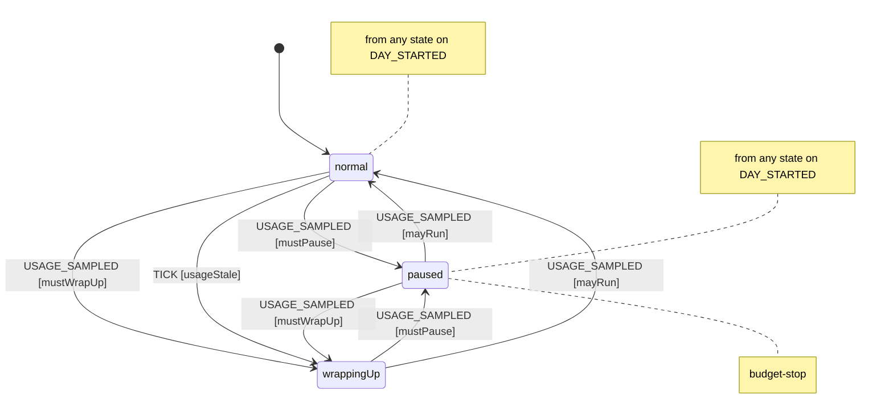
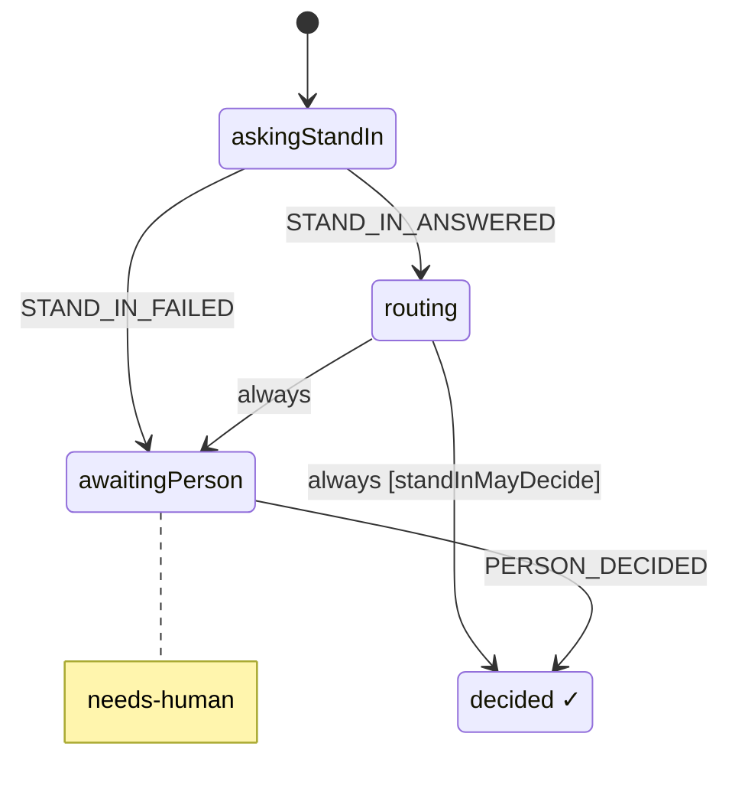
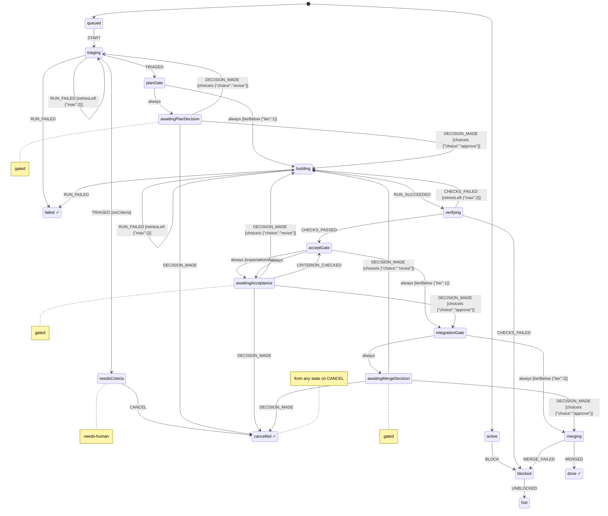
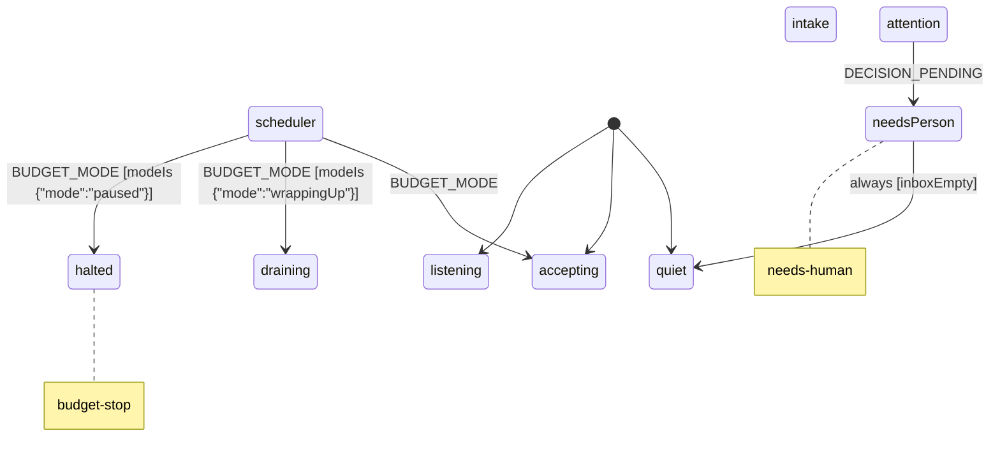

# Harness spec (generated)

Generated from `packages/harness/spec/*.machine.json` by `npm run spec:render`. Do not edit by hand: change the JSON.

## budget (v0.1.0)

Spends a daily slice of the person's 7-day Claude usage window and watches the 5-hour window. Utilization values are 0..1 shares of each window. Today's spend (spentToday) accumulates per sample; when the 7-day window resets mid-day (sevenDayResetsAt changes or utilization drops) it counts on from 0. A TICK judges an old reading by the work done since, not by its age alone: with no reading, or one older than backstopMs (24h), it drains a normal budget to wrappingUp. A TICK that carries costSince (the dollars of ledger turns filed since the newest reading) projects today's spend as spentToday + costSince x costRate (7-day share per dollar, conservative by default) and drains only when that reaches the soft limit, so an idle harness keeps accepting on an old reading. A TICK without costSince keeps the plain age rule (staleAfterMs). A fresh reading lifts it.

States:

- `normal`: Work may start.
- `wrappingUp`: Soft limit reached: start nothing new, bring work in flight to a checkpoint.
- `paused` (tags: `budget-stop`): Daily allowance spent or the 5-hour window nearly full: no turns except to save state.

Effects and context updates: `applyConfig`, `recordUsage`, `reportMode`, `startDay`

Guards: `fiveHourExhausted`, `mayRun`, `mustPause`, `mustWrapUp`, `usageStale`

## decision (v0.1.0)

One decision. The stand-in answers first; it decides alone only where its autonomy for this decision class is earned, otherwise the person decides on a card with its recommendation. Each input of standInMayDecide has one supplier, and none of them is the stand-in's caller: tier is the item's, set by triage (TRIAGED), never by the request; expectationsMet is the item's, from its acceptGate, for an accept decision; autonomy is the ladder's rung for the class over the store's own decided decisions (its logPrecedent effects and answered audits dated at or before the spawn; no log file kept by hand), which the harness reads when it spawns the decision (recommend if they cannot be read, so the person decides); threshold is the constant in this machine's context; confidence is the stand-in's, the only number its answer carries. Only a person's tap decides for the person: the machine checks that PERSON_DECIDED says actor person and source tap with the card's message id; that the tap is real is checked afterwards against the platform.

States:

- `routing`: The stand-in decides alone when the tier is below 2, the class's autonomy (set at spawn from the ladder) is act, its confidence is at or above the machine's threshold, and, for an accept decision, the item's expectationsMet was true when the decision opened (false or unknown is not); otherwise the person decides.
- `awaitingPerson` (tags: `needs-human`): A decision card is in front of the person, with the stand-in's recommendation.

Refused (nothing changes and nothing is written):

- `STAND_IN_ANSWERED` in `askingStandIn`, when `unattested` {"actor":"session"}: Refused unless a session sends it: the stand-in is a session.
- `STAND_IN_ANSWERED` in `askingStandIn`, when `answeredByOrchestratorOrWorker`: Refused from the orchestrator and from every worker that reported a run for this item (both recorded on the decision when it is spawned): only the stand-in answers, never the party whose work it judges or the one that routes it. The machine compares the ids it is given; who the sessions are is checked afterwards.
- `STAND_IN_ANSWERED` in `askingStandIn`, when `answerOverreaches`: Refused unless the answer is exactly a choice, a confidence between 0 and 1, and optionally a reason. An answer that carries autonomy or threshold is refused: the machine holds both. A missing confidence is refused; there is no default.
- `PERSON_DECIDED` in `awaitingPerson`, when `unattested` {"actor":"person","source":"tap"}: Refused unless the actor is a person and the source a tap whose ref is the decision card's message id. The machine checks the kinds and that the id is there; whether the tap happened is checked afterwards against the platform.

Effects and context updates: `acceptStandInChoice`, `askStandIn`, `logPrecedent`, `notifyInboxClosed`, `notifyInboxOpened`, `postDecisionCard`, `recordPersonChoice`, `recordStandInAnswer`, `reportDecision`

Guards: `answerOverreaches`, `answeredByOrchestratorOrWorker`, `standInMayDecide`, `unattested`

## workItem (v0.1.0)

One thing moving through the pipeline: a change to one project of the monorepo, from request to merge. Runs and merges happen outside the machine; their results come back as events on later wakes. The request names the work (id, project, title, what the person expects in their own words) and nothing the machine holds: tier and criteria come from TRIAGED, sent by a triager who is not the requester, the orchestrator or a worker, and nothing leaves triage before it. Run results come from a worker other than the orchestrator, whose id the harness passes in (orchestrator); every worker that reports a run, succeeded or failed, is recorded (workers), and both ids go to every decision the item opens, so neither can answer as the stand-in. Each criterion is checked by CRITERION_CHECKED from an actor who is neither the orchestrator nor a worker; the stand-in may approve accept only when expectationsMet holds, and a new build clears the checks. Tier 0 still has no plan or accept gate. That is acceptable for now because the tier comes from triage, not from the filer. CI and merge results come only from GitHub wakes, which from-github applies only after GitHub's REST API agrees. The machine checks actor and source kinds, that a ref is there, and that ids differ; who the sessions are is checked afterwards against the platform.

States:

- `active.queued`: Waiting for the scheduler to give it a slot.
- `active.triaging`: Scope, project, tier and acceptance criteria. The triage run's result is TRIAGED {tier, criteria}, from the triager; the item leaves triage only on it. A triager's failed run is a worker's run like any other.
- `active.needsCriteria` (tags: `needs-human`): Triage gave no criteria, so nothing could ever show the work is done: the item waits for the person and nothing proceeds from here. Missing criteria never count as met. The way out is to cancel it; a new request with what done looks like starts again.
- `active.awaitingPlanDecision` (tags: `gated`)
- `active.building`: A worker thread builds on its own branch and opens a PR. Every build starts with no criterion checked: a check of an earlier build is not evidence for this one.
- `active.verifying`: CI, spec checks and a reviewer run against the acceptance criteria. The reviewer sends one CRITERION_CHECKED {criterion, verdict, evidence} per criterion; the latest verdict for a criterion counts.
- `active.acceptGate`: expectationsMet is true only when every criterion's latest CRITERION_CHECKED says met, with evidence, from an actor who is neither the orchestrator nor one of the item's workers now. Unmet, unclear, unchecked or no criteria are not met. The accept decision opens with the answer, and when it is false the stand-in cannot decide it, so the person does.
- `active.awaitingAcceptance` (tags: `gated`): Evidence against each acceptance criterion: is the work doing what the person expected? A criterion checked now takes the item back through acceptGate, which withdraws this decision and opens a new one with the new answer.
- `active.awaitingMergeDecision` (tags: `gated`): Merge to main: the person decides, the stand-in recommends.
- `blocked`: Waiting on something outside the item (a dependency, a conflict, a failing check). Resumes where it stopped.

Refused (nothing changes and nothing is written):

- `ORCHESTRATOR_STARTED` in any state, when `fromOutside`: Sent by the harness when an orchestrator starts inside the harness; the same event from outside (any event with an actor) is refused.
- `TRIAGED` in `active.triaging`, when `triagedByParty`: Refused from the requester's actor, the orchestrator (or while none is known), every worker on the item and an event with no actor: the tier and the criteria are not set by the party that asked for the work, routes it or does it. The machine compares the ids it is given; who the sessions are is checked afterwards.
- `TRIAGED` in `active.triaging`, when `triageOverreaches`: Refused unless tier is 0, 1 or 2, and criteria, when given, is a list of non-empty strings. A missing criteria list is no criteria.
- `RUN_FAILED` in `active.triaging`, when `reportedByOrchestrator`: Refused when the orchestrator reports the run itself, or no orchestrator is known yet: a run result comes from a worker, an actor other than the orchestrator. The machine compares the ids it is given; that the worker really ran is checked afterwards.
- `DECISION_MADE` in `active.awaitingPlanDecision`, when `fromOutside`: Sent by the item's own decision when it is decided inside the harness; the same event from outside (any event with an actor) is refused.
- `RUN_SUCCEEDED` in `active.building`, when `reportedByOrchestrator`: Refused when the orchestrator reports the run itself, or no orchestrator is known yet: a run result comes from a worker, an actor other than the orchestrator. The machine compares the ids it is given; that the worker really ran is checked afterwards.
- `RUN_FAILED` in `active.building`, when `reportedByOrchestrator`: Refused when the orchestrator reports the run itself, or no orchestrator is known yet: a run result comes from a worker, an actor other than the orchestrator. The machine compares the ids it is given; that the worker really ran is checked afterwards.
- `CHECKS_PASSED` in `active.verifying`, when `unattested` {"actor":"github","source":"github-wake"}: Refused unless a CI result comes from GitHub: actor github, source github-wake, with the GitHub fact as ref. The machine checks the kinds and that a ref is there; harness from-github sends it only after reading the PR from GitHub's REST API and finding the same result, which the ref names.
- `CHECKS_FAILED` in `active.verifying`, when `unattested` {"actor":"github","source":"github-wake"}: Refused unless a CI result comes from GitHub: actor github, source github-wake, with the GitHub fact as ref. The machine checks the kinds and that a ref is there; harness from-github sends it only after reading the PR from GitHub's REST API and finding the same result, which the ref names.
- `CRITERION_CHECKED` in `active.verifying`, when `checkedByParty`: Refused from the orchestrator (or while none is known), every worker on the item and an event with no actor: a criterion is checked by someone who did not do or route the work. The machine compares the ids it is given; who the sessions are is checked afterwards.
- `CRITERION_CHECKED` in `active.verifying`, when `checkOverreaches`: Refused unless criterion is one of the item's criteria, verdict is met, unmet or unclear, and a met verdict carries evidence (a non-empty string).
- `DECISION_MADE` in `active.awaitingAcceptance`, when `fromOutside`: Sent by the item's own decision when it is decided inside the harness; the same event from outside (any event with an actor) is refused.
- `CRITERION_CHECKED` in `active.awaitingAcceptance`, when `checkedByParty`: Refused from the orchestrator (or while none is known), every worker on the item and an event with no actor: a criterion is checked by someone who did not do or route the work. The machine compares the ids it is given; who the sessions are is checked afterwards.
- `CRITERION_CHECKED` in `active.awaitingAcceptance`, when `checkOverreaches`: Refused unless criterion is one of the item's criteria, verdict is met, unmet or unclear, and a met verdict carries evidence (a non-empty string).
- `DECISION_MADE` in `active.awaitingMergeDecision`, when `fromOutside`: Sent by the item's own decision when it is decided inside the harness; the same event from outside (any event with an actor) is refused.
- `MERGED` in `active.merging`, when `unattested` {"actor":"github","source":"github-wake"}: Refused unless a merge comes from GitHub: actor github, source github-wake, with the GitHub fact as ref. The machine checks the kinds and that a ref is there; harness from-github sends it only after reading the PR from GitHub's REST API and finding the same result, which the ref names.

Effects and context updates: `checkpoint`, `clearChecks`, `countRetry`, `dispatchRun`, `mergePullRequest`, `openDecision`, `recordCheck`, `recordChoice`, `recordExpectations`, `recordOrchestrator`, `recordRun`, `recordTriage`, `recordWorker`, `reportBlocked`, `reportFinished`, `withdrawDecision`

Guards: `checkOverreaches`, `checkedByParty`, `choiceIs`, `expectationsMet`, `fromOutside`, `noCriteria`, `reportedByOrchestrator`, `retriesLeft`, `tierBelow`, `triageOverreaches`, `triagedByParty`, `unattested`

## harness (v0.1.0)

The root actor, held by the orchestrator thread. Takes requests, keeps 2-4 items in flight within budget, and keeps the person's inbox. The orchestrator is the session that sent ORCHESTRATOR_STARTED last; items take its id from here.

States:

- `scheduler.accepting`: Start ready items while fewer than wipLimit are in flight.
- `scheduler.draining`: Soft budget limit: nothing new starts; items in flight are told to wrap up.
- `scheduler.halted` (tags: `budget-stop`): Budget stop: nothing runs until usage allows.
- `attention.quiet`: Nothing needs the person.
- `attention.needsPerson` (tags: `needs-human`)

Refused (nothing changes and nothing is written):

- `ORCHESTRATOR_STARTED` in any state, when `unattested` {"actor":"session"}: Refused unless the actor is a session. Its id becomes the orchestrator's, here and in every queued or in-flight item, so no run it reports itself is taken.
- `REQUEST_RECEIVED` in `intake.listening`, when `requestOverreaches`: Refused when the request has no id, or sets a field the work item's machine holds (tier, criteria, checks, workers, orchestrator, requester and the rest of its context, all but id and project). The filer names the work; triage sets the tier and the criteria. The requester is the event's actor, recorded by the item.
- `BUDGET_MODE` in `scheduler`, when `fromOutside`: Sent by the budget actor when its mode changes inside the harness; the same event from outside (any event with an actor) is refused.
- `REQUEST_RECEIVED` in `scheduler.accepting`, when `requestOverreaches`: Refused when the request has no id, or sets a field the work item's machine holds (tier, criteria, checks, workers, orchestrator, requester and the rest of its context, all but id and project). The filer names the work; triage sets the tier and the criteria. The requester is the event's actor, recorded by the item.

Effects and context updates: `addToInbox`, `publishDigest`, `recordBudgetMode`, `recordOrchestrator`, `releaseSlot`, `removeFromInbox`, `spawnWorkItem`, `startReadyItems`, `wrapUpInFlight`

Guards: `fromOutside`, `inboxEmpty`, `modeIs`, `requestOverreaches`, `unattested`
