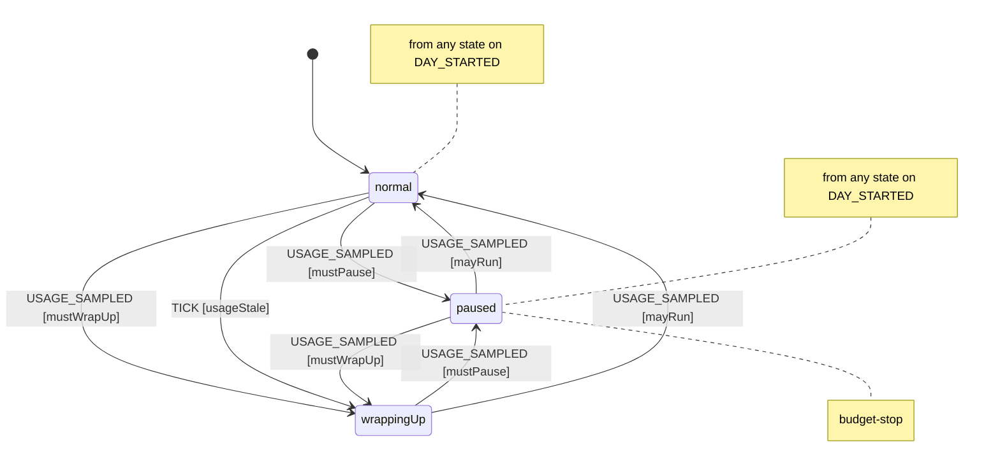
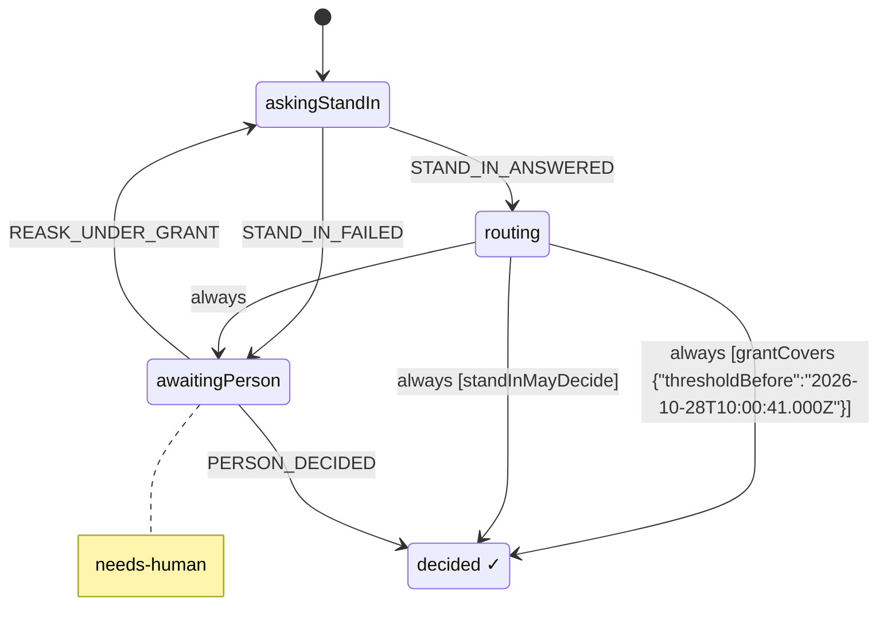
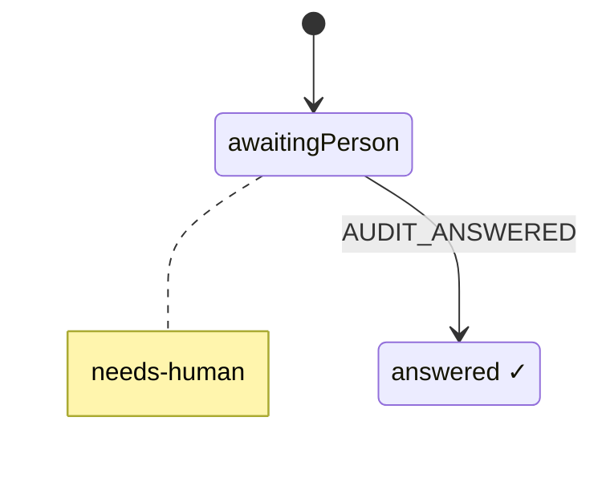
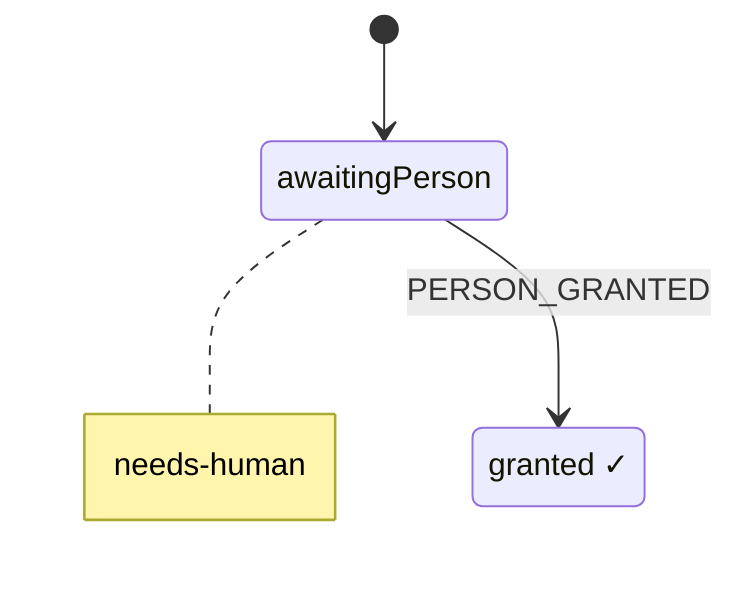
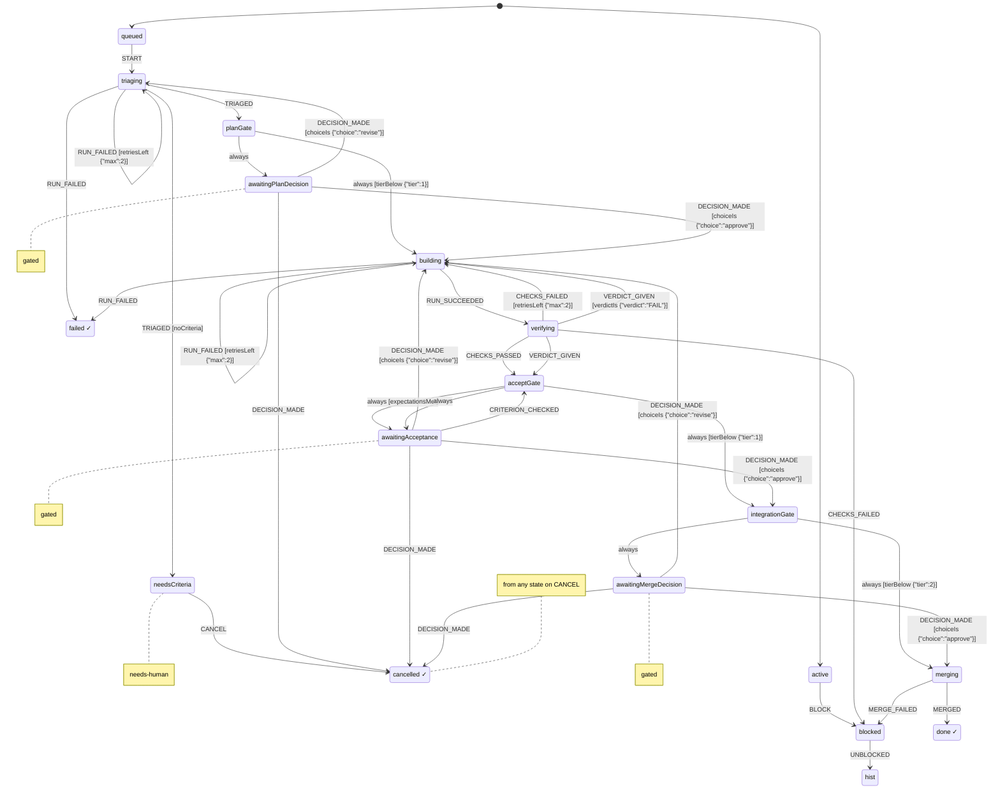
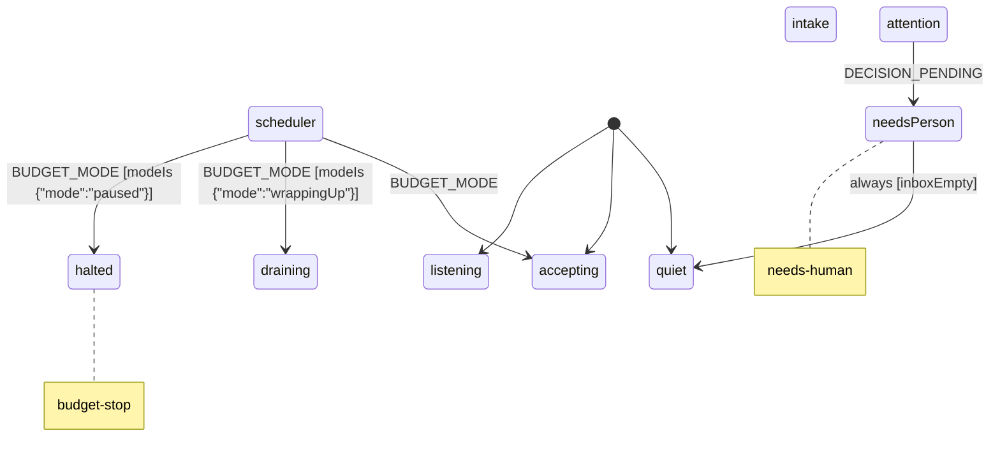

# Harness spec (generated)

Generated from `packages/harness/spec/*.machine.json` by `npm run spec:render`. Do not edit by hand: change the JSON.

## budget (v0.1.0)

Spends a daily slice of the person's 7-day Claude usage window and watches the 5-hour window. Utilization values are 0..1 shares of each window. Today's spend (spentToday) accumulates per sample; when the 7-day window resets mid-day (sevenDayResetsAt changes or utilization drops) it counts on from 0. A TICK judges an old reading by the work done since, not by its age alone: with no reading, or one older than backstopMs (24h), it drains a normal budget to wrappingUp. A TICK that carries costSince (the dollars of ledger turns filed since the newest reading) projects today's spend as spentToday + costSince x costRate (7-day share per dollar, conservative by default) and drains only when that reaches the soft limit, so an idle harness keeps accepting on an old reading. A TICK without costSince keeps the plain age rule (staleAfterMs). A fresh reading lifts it.

States:

- `normal`: Work may start.
- `wrappingUp`: Soft limit reached: start nothing new, bring work in flight to a checkpoint.
- `paused` (tags: `budget-stop`): Daily allowance spent or the 5-hour window nearly full: no turns except to save state.

Routes (the ids a log row records; replay takes them as logged):

- `dayStartsPaused`: `DAY_STARTED` in any state, when `fiveHourExhausted`, to `.paused`
- `normalPauses`: `USAGE_SAMPLED` in `normal`, when `mustPause`, to `paused`
- `normalWrapsUp`: `USAGE_SAMPLED` in `normal`, when `mustWrapUp`, to `wrappingUp`
- `staleWrapsUp`: `TICK` in `normal`, when `usageStale`, to `wrappingUp`
- `wrappingUpPauses`: `USAGE_SAMPLED` in `wrappingUp`, when `mustPause`, to `paused`
- `wrappingUpResumes`: `USAGE_SAMPLED` in `wrappingUp`, when `mayRun`, to `normal`
- `pausedResumes`: `USAGE_SAMPLED` in `paused`, when `mayRun`, to `normal`
- `pausedWrapsUp`: `USAGE_SAMPLED` in `paused`, when `mustWrapUp`, to `wrappingUp`

Effects and context updates: `applyConfig`, `recordUsage`, `reportMode`, `startDay`

Guards: `fiveHourExhausted`, `mayRun`, `mustPause`, `mustWrapUp`, `usageStale`

## decision (v0.1.0)

One decision. The stand-in answers first; it decides alone only where the person's live grant covers the decision (grantCovers, spec grant), whatever its confidence, or its autonomy for this decision class is earned and its confidence reaches the threshold (standInMayDecide, the ladder), otherwise the person decides on a card with its recommendation. A decision waiting on the person goes back to the stand-in when the person's live grant covers it (REASK_UNDER_GRANT, spec harness). Every decision says its door (meta.classes): a two-way door is cheaply reversible, a one-way door is not. Each input of standInMayDecide has one supplier, and none of them is the stand-in's caller: tier is the item's, set by triage (TRIAGED), never by the request; expectationsMet is the item's, from its acceptGate, for an accept decision; autonomy is the ladder's rung for the class over the store's own decided decisions (its logPrecedent effects and the AUDIT_ANSWERED events dated at or before the spawn; no file kept by hand), which the harness reads when it spawns the decision (recommend if they cannot be read, so the person decides); threshold is the constant in this machine's context; confidence is the stand-in's, the only number its answer carries. Only a person's tap decides for the person, and only on the card the machine asked for: postDecisionCard asks the host to post the card (its detail carries the decision's item and address, item:<item>/<id>, where the ack and the tap go), the host's ack of that effect names the card's message id (CARD_POSTED, which the decision records once), and PERSON_DECIDED is taken only from the person with source tap:<that id> and a choice among the card's options. A tap on no card, an unposted card or another decision's card is refused; that the tap is real is checked afterwards against the platform (harness verify-taps, by another session, which names the session that relayed each tap: relayedBy on the log row). The item passes in its roles when it opens the decision (requester, triagers, workers, checkers, answerers; spec workItem, Roles), and a stand-in answer from a session holding another of them is refused; the answering session is reported to the item (STAND_IN_RECORDED), which records it as an answerer.

Decision classes:

- `plan`: two-way door. Approving a plan only lets the build start; a revise or a cancel later undoes it.
- `accept`: two-way door. Accepting the work only moves the item on toward its merge; nothing reaches main until it merges.
- `merge`: one-way door. Merging puts the change on main for everyone; undoing it takes a revert.

Each decision class has one door, two-way (cheaply reversible) or one-way, and a decision takes its class's door when the item opens it (context.door); a class not listed here is a one-way door. The grant's checklist offers these classes, and a grant decides a one-way door only when it names that class and has the one-way-door box ticked (spec grant).

States:

- `askingStandIn` (waits on a pending `askStandIn`): The stand-in is asked: the askStandIn effect stays pending until its answer is recorded (harness answer acks it only then), or until the item withdraws the decision, which closes it (spec workItem, withdrawDecision closes). A decision here with no pending askStandIn effect for it is stuck, and harness doctor names it (meta.waitsOn).
- `routing`: The stand-in decides alone under the person's grant (grantCovers) when the harness's grant, read as the answer arrived (readLiveGrant: the one grant the harness holds, so a replaced grant is gone), has not ended by the answer's own time (receivedAt, before until), names this decision's class, and, for a one-way door, has the one-way-door box; the answer carries a reason, and for an accept decision the item's expectationsMet was true when it opened. Its confidence does not matter there: under a grant the person has said they trust the stand-in's judgement, so an answer honest about doubt decides like a sure one, and its confidence goes on the granted row for the person to see and reverse. Only an answer received before thresholdBefore (when this rule was loosened: issue #58, live from the landing of PR #60) also needs its confidence at or above the machine's threshold, the rule it was logged under, so replay routes an older log as it was routed. Tier and autonomy do not matter there. Otherwise, as before the grant (the ladder rule, standInMayDecide), it decides alone when the tier is below 2, the class's autonomy (set at spawn from the ladder) is act, its confidence is at or above the machine's threshold, and, for an accept decision, the item's expectationsMet was true when the decision opened (false or unknown is not); otherwise the person decides. Which rule decided is recorded (authority: grant or ladder) and logged with the precedent. A decision made under the grant also reports itself to the harness (DECIDED_UNDER_GRANT, reportGrantDecision) with its choice, confidence, reason and the grant's card, and the harness keeps the row in context.granted, the one list mission control and the daily audit show the person.
- `awaitingPerson` (tags: `needs-human`): A decision card is in front of the person, with the stand-in's recommendation. The card is the one the machine asked for (postDecisionCard); its message id arrives with the ack (CARD_POSTED), and only a tap on it decides. While it waits, the orchestrator can send it back to the stand-in for a fresh answer, but only while the person's live grant covers it (REASK_UNDER_GRANT to the harness, which checks the grant and passes it down through the item): the card is cleared, so a tap on it decides nothing, and if the fresh answer comes back here a new card is asked for.

Refused (admission rules: nothing changes and nothing is written):

- `STAND_IN_ANSWERED` in `askingStandIn`, when `unattested` {"actor":["session","agent"]}: Refused unless a session or an agent sends it: the stand-in is a session or a subagent of one (harness meta.actors).
- `STAND_IN_ANSWERED` in `askingStandIn`, when `answeredByOrchestratorOrWorker`: Refused from the orchestrator and from every worker that reported a run for this item (both recorded on the decision when it is spawned): only the stand-in answers, never the party whose work it judges or the one that routes it. The machine compares the ids it is given; who the sessions are is checked afterwards.
- `STAND_IN_ANSWERED` in `askingStandIn`, when `holdsAnotherRole` {"role":"answerer"}: Refused when the sender, a session or an agent (harness meta.actors), already holds another role on the item (requester, triager, worker or criterion checker; the item passes them in when it opens the decision): the stand-in that answers played no other part. The person and GitHub are exempt. The machine compares the whole actor; harness verify-actors checks sessions against the platform's ledger and agents against the SubagentStart records.
- `STAND_IN_ANSWERED` in `askingStandIn`, when `answerOverreaches`: Refused unless the answer is exactly a choice, a confidence between 0 and 1, and optionally a reason. An answer that carries autonomy or threshold is refused: the machine holds both. A missing confidence is refused; there is no default.
- `STAND_IN_ANSWERED` in `askingStandIn`, when `choiceNotOffered`: Refused unless the answer's choice is one of the decision's options (context.options: approve, revise, reject), the same choices the person's card offers; this list is the one place that says which choices a stand-in may give (harness answer takes one flag per option). At every gate approve moves the item on, revise sends it back (to building from the accept and land gates, to triage from the plan gate, as a person's revise tap does) and reject cancels it (spec workItem, each gate's DECISION_MADE).
- `CARD_POSTED` in `awaitingPerson`, when `unattested` {"actor":"session"}: Refused unless a session sends it: the host session that posted the card acks the postDecisionCard effect with the card's message id (harness ack <effect> --card <cmsg id>, the only way to name it). A second ack of the effect is refused and writes nothing.
- `CARD_POSTED` in `awaitingPerson`, when `cardOverreaches`: Refused unless it names one message id (cmsg_...) and this decision has no card yet: one decision, one card, recorded once.
- `PERSON_DECIDED` in `awaitingPerson`, when `unattested` {"actor":"person","source":"tap"}: Refused unless the actor is a person and the source a tap.
- `PERSON_DECIDED` in `awaitingPerson`, when `tapUnbound`: Refused unless the tap's ref is this decision's card: the message id CARD_POSTED recorded when the host acked this decision's postDecisionCard effect. A tap before the card is posted, on another decision's card or on no card at all changes nothing. Whether the tap happened is checked afterwards against the platform (harness verify-taps).
- `PERSON_DECIDED` in `awaitingPerson`, when `choiceNotOffered`: Refused unless the choice is one of the card's options (the decision's options: approve, revise, reject).
- `REASK_UNDER_GRANT` in `awaitingPerson`, when `fromOutside`: Sent by the decision's item, passing on the harness's REASK_UNDER_GRANT (spec harness), which takes it only from the orchestrator and only while the person's live grant covers this decision; the same event from outside (any event with an actor) is refused.

Routes (the ids a log row records; replay takes them as logged):

- `grantDecides`: `always` in `routing`, when `grantCovers` {"thresholdBefore":"2026-10-28T10:00:41.000Z"}, to `decided`
- `standInDecides`: `always` in `routing`, when `standInMayDecide`, to `decided`

Effects and context updates: `acceptStandInChoice`, `askStandIn`, `clearCard`, `logPrecedent`, `notifyInboxClosed`, `notifyInboxOpened`, `postDecisionCard`, `readLiveGrant`, `recordCard`, `recordPersonChoice`, `recordStandInAnswer`, `reportAnswerer`, `reportDecision`, `reportGrantDecision`

Guards: `answerOverreaches`, `answeredByOrchestratorOrWorker`, `cardOverreaches`, `choiceNotOffered`, `fromOutside`, `grantCovers`, `holdsAnotherRole`, `standInMayDecide`, `tapUnbound`, `unattested`

## audit (v0.1.0)

The day's stand-in audit. A class nobody checks never moves its ladder, so once a day the harness picks up to 3 decisions the stand-in made alone (AUDIT_PICKED, sent to the harness by the session that read the decision log; the picks are logPrecedent effect ids, which the decision log resolves from the store's own outbox and ignores when they name no stand-in decision). The audit asks the host to post one card (postAuditCard): option 0 confirms every pick, option i reverses pick i. The host's ack of that effect names the card's message id (CARD_POSTED), and the answer is AUDIT_ANSWERED from the person, by a tap on that card, exactly as a decision's PERSON_DECIDED. The decision log and the ladder read the answer from the event log (one person's decision per pick, dated when the person answered); no file in the store is read for a rung.

States:

- `awaitingPerson` (tags: `needs-human`): The audit card is in front of the person. Its message id arrives with the ack of postAuditCard (CARD_POSTED), and only a tap on it answers.
- `answered`: The person answered. The event log holds the answer; the decision log turns it into one person's decision per pick.

Refused (admission rules: nothing changes and nothing is written):

- `CARD_POSTED` in `awaitingPerson`, when `unattested` {"actor":"session"}: Refused unless a session sends it: the host session that posted the card acks the postAuditCard effect with the card's message id (harness ack <effect> --card <cmsg id>).
- `CARD_POSTED` in `awaitingPerson`, when `cardOverreaches`: Refused unless it names one message id (cmsg_...) and this audit has no card yet.
- `AUDIT_ANSWERED` in `awaitingPerson`, when `unattested` {"actor":"person","source":"tap"}: Refused unless the actor is a person and the source a tap.
- `AUDIT_ANSWERED` in `awaitingPerson`, when `tapUnbound`: Refused unless the tap's ref is this audit's card, the message id CARD_POSTED recorded on the ack of its postAuditCard effect. A tap on no card, an unposted card or another card changes nothing.
- `AUDIT_ANSWERED` in `awaitingPerson`, when `optionNotOffered`: Refused unless the option is one of the card's: 0 (all right) or i, 1 to the number of picks (reverse pick i).

Effects and context updates: `postAuditCard`, `recordAuditAnswer`, `recordCard`

Guards: `cardOverreaches`, `optionNotOffered`, `tapUnbound`, `unattested`

## grant (v0.1.0)

The person's grant to the stand-in: which decision kinds it may decide alone, and until when. A session the person asked sends GRANT_ASKED to the harness, which opens this actor (grant:<n>) with a checklist the machine generates (meta.checklist): one tick per decision class (spec decision meta.classes, each marked with its door), the one-way-door box, and end times counted from the ask. The actor asks the host to post the checklist card (postGrantCard); the host's ack names the card's message id (CARD_POSTED), and the person's ticks arrive as one tap event naming that card, PERSON_GRANTED {picks}, taken exactly like PERSON_DECIDED. The grant it reports to the harness (GRANT_GIVEN) is {card, kinds, oneWay, until, at} built from the picks alone; the harness holds one grant, so the tap replaces any earlier one. A grant decides a two-way door whose class it names, and a one-way door only when it names the class and has the one-way-door box; it decides nothing at or after until. Tapping a checklist with no kind ticked ends the live grant. The person can also grant in their own words: the same PERSON_GRANTED {picks}, from a message instead of a tap, goes to the harness itself (spec harness), with no checklist; a tap or a message replaces whatever grant came before.

Checklist: end times 2, 8, 24, 72 hours after the ask. The options, generated when the ask is opened: kind:<class> for every class in spec decision meta.classes, one-way (the one-way-door box), and until:<ISO time> for each of endsAfterHours after the ask's own time (receivedAt). A tap names any of the kinds, the box or not, and exactly one end time.

States:

- `awaitingPerson` (tags: `needs-human`): The checklist card is in front of the person. Its message id arrives with the ack of postGrantCard (CARD_POSTED), and only a tap on it grants.
- `granted`: The person ticked the checklist. The harness holds the grant (GRANT_GIVEN) until its end time or the next tap on a checklist.

Refused (admission rules: nothing changes and nothing is written):

- `CARD_POSTED` in `awaitingPerson`, when `unattested` {"actor":"session"}: Refused unless a session sends it: the host session that posted the checklist acks the postGrantCard effect with the card's message id (harness ack <effect> --card <cmsg id>).
- `CARD_POSTED` in `awaitingPerson`, when `cardOverreaches`: Refused unless it names one message id (cmsg_...) and this ask has no card yet.
- `PERSON_GRANTED` in `awaitingPerson`, when `unattested` {"actor":"person","source":"tap"}: Refused unless the actor is a person and the source a tap: no session, agent or timer can grant.
- `PERSON_GRANTED` in `awaitingPerson`, when `tapUnbound`: Refused unless the tap's ref is this ask's card, the message id CARD_POSTED recorded on the ack of its postGrantCard effect. A tap on no card, an unposted card, a decision's or an audit's card, or an earlier checklist changes nothing.
- `PERSON_GRANTED` in `awaitingPerson`, when `picksNotOffered`: Refused unless picks is a list of the card's own options, each at most once, with exactly one end time: a kind, a box or an end time the machine did not generate is refused.

Effects and context updates: `postGrantCard`, `recordCard`, `recordPicks`, `reportGrant`

Guards: `cardOverreaches`, `picksNotOffered`, `tapUnbound`, `unattested`

## workItem (v0.1.0)

One thing moving through the pipeline: a change to one project of the monorepo, from request to merge. Runs and merges happen outside the machine; their results come back as events on later wakes. The request names the work (id, project, title, what the person expects in their own words) and nothing the machine holds: tier and criteria come from TRIAGED, sent by a triager who is not the requester, the orchestrator or a worker, and nothing leaves triage before it. Run results come from a worker other than the orchestrator, whose id the harness passes in (orchestrator); every worker that reports a run, succeeded or failed, is recorded (workers), and both ids go to every decision the item opens, so neither can answer as the stand-in. Each criterion is checked by CRITERION_CHECKED from an actor who is neither the orchestrator nor a worker; the stand-in may approve accept only when expectationsMet holds, and a new build clears the checks. A tier, once triage sets it, never goes down: a re-triage after a revise may keep or raise it. Tier 0 still has no plan or accept gate. That is acceptable for now because the tier comes from triage, not from the filer. CI and merge results come only from GitHub wakes, which from-github applies only after GitHub's REST API agrees. The machine checks actor and source kinds, that a ref is there, and that ids differ; who the sessions are is checked afterwards against the platform.

Roles: the item records who played each part, by actor: its requester (REQUEST_RECEIVED), triagers (TRIAGED), workers (RUN_SUCCEEDED, RUN_FAILED), criterion checkers (CRITERION_CHECKED) and stand-in answerers (STAND_IN_ANSWERED on any of its decisions, which the decision reports up as STAND_IN_RECORDED). One actor plays one part on an item: an event whose actor already holds a different role there is refused (holdsAnotherRole), so the triager cannot build, check or answer, a worker cannot triage, check or answer, a checker cannot build or answer, and the stand-in cannot triage, build or check. Each decision the item opens takes the roles as they stand. Roles are held by the worker actors, sessions and agents (harness meta.actors), compared by the whole actor: a subagent is agent <session_id>/<agent_id>, so two subagents of one session are distinct from each other and from their parent session, and the lead's triager, builder and checker subagents can play different parts. The person and GitHub are exempt: they are never recorded or compared. A session id is the platform's: the CLI takes CLAUDE_CODE_SESSION_ID and refuses an --actor session:<id> that differs; for a subagent it takes the agent from the plugin's PreToolUse hook (HARNESS_AGENT) and refuses any --actor session or other agent. harness verify-actors checks every session in the log against the Stop hook's ledger and every agent against the SubagentStart hook's record.

Workers: the lead spawns its builder, verifier and triager subagents through the plugin's spawn gate, and each spawn is an event on the item (WORKER_SPAWNED, sent by the spawning session) recording the role, the sha256 of the brief, the agent type, the model, the agent definition and the harness version; the plugin's SubagentStart hook binds the new agent to it (WORKER_STARTED), and the agent actor (#33) is recorded on the spawn. The hook's input names the agent and its type but not the Agent call, so it binds to the one spawn of that type the session has waiting: a session has at most one unbound spawn of an agent type at a time, across all items (harness meta.invariants oneUnboundSpawn), and a spawn whose agent never started is closed by the session that spawned it (SPAWN_CLOSED), or lapses after the bind window, so it binds no later agent. A triager is taken while the item is triaging, a builder while it is building, a verifier once it is built. Before any builder is spawned the verifier's brief is fixed by its hash (VERIFIER_BRIEF_FIXED, once), so it cannot be written after reading the builder's report: a builder spawn is refused until then, and a verifier spawn whose brief hash differs from the fixed one is refused. A stand-in is spawned the same way while a decision is open. What an agent may send at all is one allow-list by its role on the item (harness meta.agentEvents): a triager TRIAGED, a builder RUN_SUCCEEDED and RUN_FAILED, a verifier CRITERION_CHECKED and VERDICT_GIVEN, a stand-in STAND_IN_ANSWERED on the item's decisions; an agent spawned with no role, or bound to another item, sends nothing. The verifier's verdict is VERDICT_GIVEN (PASS or FAIL for one head sha, the text posted verbatim as a COMMENT review on that sha, ending with the verifier brief's sha256), and MERGED is taken only for a head whose latest verdict is PASS. The host's own checks around these (the call record behind an agent actor, the role line of a brief, the store being reachable, the merge pinning its head and the review being on GitHub) are named in harness meta.invariants.

States:

- `active.queued`: Waiting for the scheduler to give it a slot.
- `active.triaging`: Scope, project, tier and acceptance criteria. The triage run's result is TRIAGED {tier, criteria}, from the triager; the item leaves triage only on it. A revise at the plan gate comes back here, and the tier it already has is a floor: a later triage may raise it, never lower it. A triager's failed run is a worker's run like any other.
- `active.needsCriteria` (tags: `needs-human`): Triage gave no criteria, so nothing could ever show the work is done: the item waits for the person and nothing proceeds from here. Missing criteria never count as met. It is in the person's inbox while it is here (counted and listed with the decisions that wait on the person), and it gives up its work-in-progress slot on entry (ITEM_PARKED), so other work starts while it waits. BLOCK and UNBLOCKED bring it back here, never to building. The way out is to cancel it; a new request with what done looks like starts again.
- `active.awaitingPlanDecision` (tags: `gated`)
- `active.building`: A worker thread builds on its own branch and opens a PR. Every build starts with no criterion checked: a check of an earlier build is not evidence for this one. A FAIL verdict in verifying comes back here too, and the item's worker reports the next round's run.
- `active.verifying`: CI, spec checks and a reviewer run against the acceptance criteria. The reviewer sends one CRITERION_CHECKED {criterion, verdict, evidence} per criterion; the latest verdict for a criterion counts. The item leaves verifying only when both CI has passed and the verifier's verdict is recorded for the same head, in whichever order they arrive: CI that passes first while the item has a verifier brief and no verdict on CI's head (awaitsVerdict; CI's sha is a prefix of the verdict's) is kept (recordChecksPassed: checksPassed, its head) and the item stays for the verdict; a verdict that comes before CI passed on its head (awaitsChecks) is recorded and the item stays for CI. The other half arriving moves it to acceptGate. Why this and not checks after CI: the accept decision then opens once, with the verifier's checks already counted in expectationsMet, so the stand-in is asked one question and can decide it under the grant; a check that arrived after CI would have reopened the decision with a new ask (issue #71). The verifier sends its criterion checks before its verdict, which ends verifying. A FAIL verdict (verdictIs FAIL) ends the round instead, CI or not: the item goes back to building with its tier, criteria, roles, workers and verifier brief hash, so the same builder reports the fixed head (RUN_SUCCEEDED), building's entry clears the round's checks and CI head, and a verifier spawned for the new head carries the brief fixed before the first round (issue #83). An item with no verifier brief fixed can be given no verdict (verdictOverreaches), so its CI does not wait for one. A new build clears checksPassed with the checks.
- `active.acceptGate`: expectationsMet is true only when every criterion's latest CRITERION_CHECKED says met, with evidence, from an actor who is neither the orchestrator nor one of the item's workers now. Unmet, unclear, unchecked or no criteria are not met. The accept decision opens with the answer, and when it is false the stand-in cannot decide it, so the person does.
- `active.awaitingAcceptance` (tags: `gated`): Evidence against each acceptance criterion: is the work doing what the person expected? A criterion checked now is recorded; when it leaves expectationsMet as the open decision has it, that decision stays open, its ask and card as they are. Only a check that changes expectationsMet takes the item back through acceptGate, which withdraws this decision and opens a new one with the new answer, so N checks open at most one new decision per change and leave one live decision. Leaving this state withdraws the decision (withdrawDecision), and withdrawing closes the decision's pending askStandIn and postDecisionCard effects (params closes; outcome withdrawn, harness meta.store closes), so no ask is left that no decision can take. Only a check received at or after since (when this rule came in: issue #84) can keep the decision; an older one always went back through acceptGate, the rule it was logged under, so the history join run without the source's outbox routes an older log as it was routed. Replay does not need since: it takes each row's route from the row, or for a row from before routes were recorded from its logged effects (harness meta.store facts).
- `active.awaitingMergeDecision` (tags: `gated`): Merge to main, a one-way door: the person decides and the stand-in recommends, unless the person's live grant names merge and has the one-way-door box (spec decision, grantCovers).
- `blocked`: Waiting on something outside the item (a dependency, a conflict, a failing check). Resumes where it stopped.

Refused (admission rules: nothing changes and nothing is written):

- `ORCHESTRATOR_STARTED` in any state, when `fromOutside`: Sent by the harness when an orchestrator starts inside the harness; the same event from outside (any event with an actor) is refused.
- `STAND_IN_RECORDED` in any state, when `fromOutside`: Sent by the item's own decision when the stand-in's answer is recorded, naming the answering session; the same event from outside (any event with an actor) is refused.
- `REASK_UNDER_GRANT` in any state, when `fromOutside`: Sent by the harness, passing on the orchestrator's REASK_UNDER_GRANT once the person's live grant covers the decision; the same event from outside (any event with an actor) is refused. The item passes it to its open decision when that is the one named (forwardReask).
- `OUT_OF_BAND` in any state, when `unattested` {"actor":"session"}: Refused unless a session sends it: the session that read the order and records it. An agent, the person, GitHub or a timer cannot.
- `OUT_OF_BAND` in any state, when `unrecordable`: Refused unless the event holds what history.schema.json declares for OUT_OF_BAND: who ordered it (orderedBy, an actor), the message that did, what was done, the gates it skipped and the PR (pr), and, when it names the head that landed (sha), all 40 hex digits of it.
- `VERIFIER_BRIEF_FIXED` in `active`, when `unattested` {"actor":["session"]}: Refused unless a session sends it: the lead fixes the verifier's brief; a subagent cannot.
- `VERIFIER_BRIEF_FIXED` in `active`, when `briefOverreaches`: Refused unless sha256 is 64 lowercase hex characters and the item has no verifier brief yet: the hash is fixed once, so a later brief cannot replace it.
- `WORKER_STARTED` in `active`, when `unattested` {"actor":["session"]}: Refused unless a session sends it: the plugin's SubagentStart hook binds the agent as the session that spawned it.
- `WORKER_STARTED` in `active`, when `noSpawnToBind` {"withinMs":300000}: Refused unless agent is <session_id>/<agent_id> of the sending session, bound to no spawn of this item yet, and the sender recorded a spawn of agentType here that is unbound, not closed and at most withinMs old; the oldest such spawn is bound.
- `SPAWN_CLOSED` in `active`, when `unattested` {"actor":["session"]}: Refused unless a session sends it: the session that spawned the agent closes its spawn.
- `SPAWN_CLOSED` in `active`, when `noSpawnToClose`: Refused unless the sender recorded a spawn here with this toolUseId that is unbound and not closed: a bound spawn keeps its agent, and a closed one stays closed.
- `TRIAGED` in `active.triaging`, when `triagedByParty`: Refused from the requester's actor, the orchestrator (or while none is known), every worker on the item and an event with no actor: the tier and the criteria are not set by the party that asked for the work, routes it or does it. The machine compares the ids it is given; who the sessions are is checked afterwards.
- `TRIAGED` in `active.triaging`, when `holdsAnotherRole` {"role":"triager"}: Refused when the sender, a session or an agent (harness meta.actors), already holds another role on this item (requester, worker, criterion checker or stand-in answerer): the triager plays no other part. The person and GitHub are exempt. The machine compares the whole actor; harness verify-actors checks sessions against the platform's ledger and agents against the SubagentStart records.
- `TRIAGED` in `active.triaging`, when `triageOverreaches`: Refused unless tier is 0, 1 or 2, and criteria, when given, is a list of non-empty strings. A missing criteria list is no criteria.
- `TRIAGED` in `active.triaging`, when `tierLowered`: Refused when the item already has a tier and this TRIAGED gives a lower one (or none). A revise sends the plan back to triage, which runs again and may keep or raise the tier but never lower it, so a second triage cannot skip a gate the first one set. The guard reads the previous tier from context, which a revise keeps; an equal or higher tier is taken.
- `RUN_FAILED` in `active.triaging`, when `reportedByOrchestrator`: Refused when the orchestrator reports the run itself, or no orchestrator is known yet: a run result comes from a worker, an actor other than the orchestrator. The machine compares the ids it is given; that the worker really ran is checked afterwards.
- `RUN_FAILED` in `active.triaging`, when `holdsAnotherRole` {"role":"worker"}: Refused when the sender, a session or an agent (harness meta.actors), already holds another role on this item (requester, triager, criterion checker or stand-in answerer): the triager, a checker or the stand-in cannot build. The person and GitHub are exempt. The machine compares the whole actor; harness verify-actors checks sessions against the platform's ledger and agents against the SubagentStart records.
- `WORKER_SPAWNED` in `active.triaging`, when `unattested` {"actor":["session"]}: Refused unless a session sends it: the lead spawns workers, and the plugin's spawn gate records the spawn as that session before the Agent call runs.
- `WORKER_SPAWNED` in `active.triaging`, when `spawnOverreaches`: Refused unless role is builder, verifier, triager or stand-in, briefSha256 is the sha256 of the brief (64 lowercase hex), agentType is a non-empty string and model, when given, is a string.
- `WORKER_SPAWNED` in `active.triaging`, when `roleNotHere` {"roles":["triager"]}: Refused unless the role is triager: a triager is spawned while the item is triaging, a builder while it is building, a verifier once it is built.
- `WORKER_SPAWNED` in `active.triaging`, when `agentTypeIsNot` {"builder":"harness:builder","verifier":"harness:verifier"}: Refused when a builder or verifier is spawned with another agent type than the plugin's standing definition for the role (plugins/harness/agents), whose rules do not drift per brief.
- `DECISION_MADE` in `active.awaitingPlanDecision`, when `fromOutside`: Sent by the item's own decision when it is decided inside the harness; the same event from outside (any event with an actor) is refused.
- `WORKER_SPAWNED` in `active.awaitingPlanDecision`, when `unattested` {"actor":["session"]}: Refused unless a session sends it: the lead spawns workers, and the plugin's spawn gate records the spawn as that session before the Agent call runs.
- `WORKER_SPAWNED` in `active.awaitingPlanDecision`, when `spawnOverreaches`: Refused unless role is builder, verifier, triager or stand-in, briefSha256 is the sha256 of the brief (64 lowercase hex), agentType is a non-empty string and model, when given, is a string.
- `WORKER_SPAWNED` in `active.awaitingPlanDecision`, when `roleNotHere` {"roles":["stand-in"]}: Refused unless the role is stand-in: while the plan decision is open, only the stand-in that answers it is spawned.
- `RUN_SUCCEEDED` in `active.building`, when `reportedByOrchestrator`: Refused when the orchestrator reports the run itself, or no orchestrator is known yet: a run result comes from a worker, an actor other than the orchestrator. The machine compares the ids it is given; that the worker really ran is checked afterwards.
- `RUN_SUCCEEDED` in `active.building`, when `holdsAnotherRole` {"role":"worker"}: Refused when the sender, a session or an agent (harness meta.actors), already holds another role on this item (requester, triager, criterion checker or stand-in answerer): the triager, a checker or the stand-in cannot build. The person and GitHub are exempt. The machine compares the whole actor; harness verify-actors checks sessions against the platform's ledger and agents against the SubagentStart records.
- `RUN_FAILED` in `active.building`, when `reportedByOrchestrator`: Refused when the orchestrator reports the run itself, or no orchestrator is known yet: a run result comes from a worker, an actor other than the orchestrator. The machine compares the ids it is given; that the worker really ran is checked afterwards.
- `RUN_FAILED` in `active.building`, when `holdsAnotherRole` {"role":"worker"}: Refused when the sender, a session or an agent (harness meta.actors), already holds another role on this item (requester, triager, criterion checker or stand-in answerer): the triager, a checker or the stand-in cannot build. The person and GitHub are exempt. The machine compares the whole actor; harness verify-actors checks sessions against the platform's ledger and agents against the SubagentStart records.
- `WORKER_SPAWNED` in `active.building`, when `unattested` {"actor":["session"]}: Refused unless a session sends it: the lead spawns workers, and the plugin's spawn gate records the spawn as that session before the Agent call runs.
- `WORKER_SPAWNED` in `active.building`, when `spawnOverreaches`: Refused unless role is builder, verifier, triager or stand-in, briefSha256 is the sha256 of the brief (64 lowercase hex), agentType is a non-empty string and model, when given, is a string.
- `WORKER_SPAWNED` in `active.building`, when `roleNotHere` {"roles":["builder"]}: Refused unless the role is builder: a triager is spawned while the item is triaging, a builder while it is building, a verifier once it is built.
- `WORKER_SPAWNED` in `active.building`, when `agentTypeIsNot` {"builder":"harness:builder","verifier":"harness:verifier"}: Refused when a builder or verifier is spawned with another agent type than the plugin's standing definition for the role (plugins/harness/agents), whose rules do not drift per brief.
- `WORKER_SPAWNED` in `active.building`, when `noVerifierBrief`: Refused while the item has no verifier brief hash (VERIFIER_BRIEF_FIXED): the verifier's brief is fixed before any builder is spawned, so it cannot be written after reading the builder's report.
- `CHECKS_PASSED` in `active.verifying`, when `unattested` {"actor":"github","source":"github-wake"}: Refused unless a CI result comes from GitHub: actor github, source github-wake, with the GitHub fact as ref. The machine checks the kinds and that a ref is there; harness from-github sends it only after reading the PR from GitHub's REST API and finding the same result, which the ref names.
- `CHECKS_FAILED` in `active.verifying`, when `unattested` {"actor":"github","source":"github-wake"}: Refused unless a CI result comes from GitHub: actor github, source github-wake, with the GitHub fact as ref. The machine checks the kinds and that a ref is there; harness from-github sends it only after reading the PR from GitHub's REST API and finding the same result, which the ref names.
- `CRITERION_CHECKED` in `active.verifying`, when `checkedByParty`: Refused from the orchestrator (or while none is known), every worker on the item and an event with no actor: a criterion is checked by someone who did not do or route the work. The machine compares the ids it is given; who the sessions are is checked afterwards.
- `CRITERION_CHECKED` in `active.verifying`, when `holdsAnotherRole` {"role":"checker"}: Refused when the sender, a session or an agent (harness meta.actors), already holds another role on this item (requester, triager, worker or stand-in answerer): the triager or the stand-in cannot check a criterion. The person and GitHub are exempt. The machine compares the whole actor; harness verify-actors checks sessions against the platform's ledger and agents against the SubagentStart records.
- `CRITERION_CHECKED` in `active.verifying`, when `checkOverreaches`: Refused unless criterion is one of the item's criteria, verdict is met, unmet or unclear, and a met verdict carries evidence (a non-empty string).
- `WORKER_SPAWNED` in `active.verifying`, when `unattested` {"actor":["session"]}: Refused unless a session sends it: the lead spawns workers, and the plugin's spawn gate records the spawn as that session before the Agent call runs.
- `WORKER_SPAWNED` in `active.verifying`, when `spawnOverreaches`: Refused unless role is builder, verifier, triager or stand-in, briefSha256 is the sha256 of the brief (64 lowercase hex), agentType is a non-empty string and model, when given, is a string.
- `WORKER_SPAWNED` in `active.verifying`, when `roleNotHere` {"roles":["verifier"]}: Refused unless the role is verifier: a triager is spawned while the item is triaging, a builder while it is building, a verifier once it is built.
- `WORKER_SPAWNED` in `active.verifying`, when `agentTypeIsNot` {"builder":"harness:builder","verifier":"harness:verifier"}: Refused when a builder or verifier is spawned with another agent type than the plugin's standing definition for the role (plugins/harness/agents), whose rules do not drift per brief.
- `WORKER_SPAWNED` in `active.verifying`, when `briefDiffers`: Refused when a verifier is spawned with a brief whose sha256 is not the verifier brief hash fixed for the item: a verifier with an edited brief, or before any was fixed, is not taken. Other roles are not judged here.
- `VERDICT_GIVEN` in `active.verifying`, when `unattested` {"actor":"agent"}: Refused unless an agent sends it: the verdict is the verifier subagent's, from its own agent actor (harness verdict).
- `VERDICT_GIVEN` in `active.verifying`, when `verdictOverreaches`: Refused unless verdict is PASS or FAIL, sha is a full 40-character head sha, review is the id of the GitHub review that carries it, and text is the verdict as posted, ending with the item's verifier brief sha256.
- `DECISION_MADE` in `active.awaitingAcceptance`, when `fromOutside`: Sent by the item's own decision when it is decided inside the harness; the same event from outside (any event with an actor) is refused.
- `CRITERION_CHECKED` in `active.awaitingAcceptance`, when `checkedByParty`: Refused from the orchestrator (or while none is known), every worker on the item and an event with no actor: a criterion is checked by someone who did not do or route the work. The machine compares the ids it is given; who the sessions are is checked afterwards.
- `CRITERION_CHECKED` in `active.awaitingAcceptance`, when `holdsAnotherRole` {"role":"checker"}: Refused when the sender, a session or an agent (harness meta.actors), already holds another role on this item (requester, triager, worker or stand-in answerer): the triager or the stand-in cannot check a criterion. The person and GitHub are exempt. The machine compares the whole actor; harness verify-actors checks sessions against the platform's ledger and agents against the SubagentStart records.
- `CRITERION_CHECKED` in `active.awaitingAcceptance`, when `checkOverreaches`: Refused unless criterion is one of the item's criteria, verdict is met, unmet or unclear, and a met verdict carries evidence (a non-empty string).
- `WORKER_SPAWNED` in `active.awaitingAcceptance`, when `unattested` {"actor":["session"]}: Refused unless a session sends it: the lead spawns workers, and the plugin's spawn gate records the spawn as that session before the Agent call runs.
- `WORKER_SPAWNED` in `active.awaitingAcceptance`, when `spawnOverreaches`: Refused unless role is builder, verifier, triager or stand-in, briefSha256 is the sha256 of the brief (64 lowercase hex), agentType is a non-empty string and model, when given, is a string.
- `WORKER_SPAWNED` in `active.awaitingAcceptance`, when `roleNotHere` {"roles":["verifier","stand-in"]}: Refused unless the role is verifier or stand-in: a triager is spawned while the item is triaging, a builder while it is building, a verifier once it is built, and a stand-in while a decision of the item is open.
- `WORKER_SPAWNED` in `active.awaitingAcceptance`, when `agentTypeIsNot` {"builder":"harness:builder","verifier":"harness:verifier"}: Refused when a builder or verifier is spawned with another agent type than the plugin's standing definition for the role (plugins/harness/agents), whose rules do not drift per brief.
- `WORKER_SPAWNED` in `active.awaitingAcceptance`, when `briefDiffers`: Refused when a verifier is spawned with a brief whose sha256 is not the verifier brief hash fixed for the item: a verifier with an edited brief, or before any was fixed, is not taken. Other roles are not judged here.
- `VERDICT_GIVEN` in `active.awaitingAcceptance`, when `unattested` {"actor":"agent"}: Refused unless an agent sends it: the verdict is the verifier subagent's, from its own agent actor (harness verdict).
- `VERDICT_GIVEN` in `active.awaitingAcceptance`, when `verdictOverreaches`: Refused unless verdict is PASS or FAIL, sha is a full 40-character head sha, review is the id of the GitHub review that carries it, and text is the verdict as posted, ending with the item's verifier brief sha256.
- `DECISION_MADE` in `active.awaitingMergeDecision`, when `fromOutside`: Sent by the item's own decision when it is decided inside the harness; the same event from outside (any event with an actor) is refused.
- `WORKER_SPAWNED` in `active.awaitingMergeDecision`, when `unattested` {"actor":["session"]}: Refused unless a session sends it: the lead spawns workers, and the plugin's spawn gate records the spawn as that session before the Agent call runs.
- `WORKER_SPAWNED` in `active.awaitingMergeDecision`, when `spawnOverreaches`: Refused unless role is builder, verifier, triager or stand-in, briefSha256 is the sha256 of the brief (64 lowercase hex), agentType is a non-empty string and model, when given, is a string.
- `WORKER_SPAWNED` in `active.awaitingMergeDecision`, when `roleNotHere` {"roles":["verifier","stand-in"]}: Refused unless the role is verifier or stand-in: a triager is spawned while the item is triaging, a builder while it is building, a verifier once it is built, and a stand-in while a decision of the item is open.
- `WORKER_SPAWNED` in `active.awaitingMergeDecision`, when `agentTypeIsNot` {"builder":"harness:builder","verifier":"harness:verifier"}: Refused when a builder or verifier is spawned with another agent type than the plugin's standing definition for the role (plugins/harness/agents), whose rules do not drift per brief.
- `WORKER_SPAWNED` in `active.awaitingMergeDecision`, when `briefDiffers`: Refused when a verifier is spawned with a brief whose sha256 is not the verifier brief hash fixed for the item: a verifier with an edited brief, or before any was fixed, is not taken. Other roles are not judged here.
- `VERDICT_GIVEN` in `active.awaitingMergeDecision`, when `unattested` {"actor":"agent"}: Refused unless an agent sends it: the verdict is the verifier subagent's, from its own agent actor (harness verdict).
- `VERDICT_GIVEN` in `active.awaitingMergeDecision`, when `verdictOverreaches`: Refused unless verdict is PASS or FAIL, sha is a full 40-character head sha, review is the id of the GitHub review that carries it, and text is the verdict as posted, ending with the item's verifier brief sha256.
- `MERGED` in `active.merging`, when `unattested` {"actor":"github","source":"github-wake"}: Refused unless a merge comes from GitHub: actor github, source github-wake, with the GitHub fact as ref. The machine checks the kinds and that a ref is there; harness from-github sends it only after reading the PR from GitHub's REST API and finding the same result, which the ref names.
- `MERGED` in `active.merging`, when `unverifiedHead`: Refused unless sha is the head merged and the item's latest verdict for that sha is the verifier's PASS: no verdict, a FAIL, or a PASS on an older head is not taken. The merge gate asks this before a merge call runs; harness doctor lists a merged PR without it.
- `WORKER_SPAWNED` in `active.merging`, when `unattested` {"actor":["session"]}: Refused unless a session sends it: the lead spawns workers, and the plugin's spawn gate records the spawn as that session before the Agent call runs.
- `WORKER_SPAWNED` in `active.merging`, when `spawnOverreaches`: Refused unless role is builder, verifier, triager or stand-in, briefSha256 is the sha256 of the brief (64 lowercase hex), agentType is a non-empty string and model, when given, is a string.
- `WORKER_SPAWNED` in `active.merging`, when `roleNotHere` {"roles":["verifier"]}: Refused unless the role is verifier: a triager is spawned while the item is triaging, a builder while it is building, a verifier once it is built.
- `WORKER_SPAWNED` in `active.merging`, when `agentTypeIsNot` {"builder":"harness:builder","verifier":"harness:verifier"}: Refused when a builder or verifier is spawned with another agent type than the plugin's standing definition for the role (plugins/harness/agents), whose rules do not drift per brief.
- `WORKER_SPAWNED` in `active.merging`, when `briefDiffers`: Refused when a verifier is spawned with a brief whose sha256 is not the verifier brief hash fixed for the item: a verifier with an edited brief, or before any was fixed, is not taken. Other roles are not judged here.
- `VERDICT_GIVEN` in `active.merging`, when `unattested` {"actor":"agent"}: Refused unless an agent sends it: the verdict is the verifier subagent's, from its own agent actor (harness verdict).
- `VERDICT_GIVEN` in `active.merging`, when `verdictOverreaches`: Refused unless verdict is PASS or FAIL, sha is a full 40-character head sha, review is the id of the GitHub review that carries it, and text is the verdict as posted, ending with the item's verifier brief sha256.

Recorded (taken as a fact: the log row is written, nothing changes):

- `OUT_OF_BAND` in any state, a final one included: Work done outside the gates, taken as a fact in any state of the item, done, failed and cancelled included (harness meta.store records): no state change, no effects. The log row is the record, and harness doctor lists it, with a landing it records out of band rather than as a problem (harness meta.invariants reviewOnHead).

Routes (the ids a log row records; replay takes them as logged):

- `triagedWithoutCriteria`: `TRIAGED` in `active.triaging`, when `noCriteria`, to `needsCriteria`
- `triageRetries`: `RUN_FAILED` in `active.triaging`, when `retriesLeft` {"max":2}, to `triaging`
- `planGateSkipped`: `always` in `active.planGate`, when `tierBelow` {"tier":1}, to `building`
- `planApproved`: `DECISION_MADE` in `active.awaitingPlanDecision`, when `choiceIs` {"choice":"approve"}, to `building`
- `planRevised`: `DECISION_MADE` in `active.awaitingPlanDecision`, when `choiceIs` {"choice":"revise"}, to `triaging`
- `buildRetries`: `RUN_FAILED` in `active.building`, when `retriesLeft` {"max":2}, to `building`
- `checksPassedBeforeVerdict`: `CHECKS_PASSED` in `active.verifying`, when `awaitsVerdict`
- `checksFailedRebuild`: `CHECKS_FAILED` in `active.verifying`, when `retriesLeft` {"max":2}, to `building`
- `verdictFailRebuilds`: `VERDICT_GIVEN` in `active.verifying`, when `verdictIs` {"verdict":"FAIL"}, to `building`
- `verdictBeforeChecks`: `VERDICT_GIVEN` in `active.verifying`, when `awaitsChecks`
- `acceptGateSkipped`: `always` in `active.acceptGate`, when `tierBelow` {"tier":1}, to `integrationGate`
- `expectationsMet`: `always` in `active.acceptGate`, when `expectationsMet`, to `awaitingAcceptance`
- `acceptApproved`: `DECISION_MADE` in `active.awaitingAcceptance`, when `choiceIs` {"choice":"approve"}, to `integrationGate`
- `acceptRevised`: `DECISION_MADE` in `active.awaitingAcceptance`, when `choiceIs` {"choice":"revise"}, to `building`
- `acceptCheckKeepsDecision`: `CRITERION_CHECKED` in `active.awaitingAcceptance`, when `expectationsUnchanged` {"since":"2026-10-28T16:10:00.000Z"}
- `integrationGateSkipped`: `always` in `active.integrationGate`, when `tierBelow` {"tier":2}, to `merging`
- `mergeApproved`: `DECISION_MADE` in `active.awaitingMergeDecision`, when `choiceIs` {"choice":"approve"}, to `merging`
- `mergeRevised`: `DECISION_MADE` in `active.awaitingMergeDecision`, when `choiceIs` {"choice":"revise"}, to `building`

Effects and context updates: `bindSpawn`, `checkpoint`, `clearChecks`, `closeSpawn`, `countRetry`, `dispatchRun`, `forwardReask`, `giveUpSlot`, `mergePullRequest`, `notifyInboxClosed`, `notifyInboxOpened`, `openDecision`, `recordAnswerer`, `recordCheck`, `recordChecksPassed`, `recordChoice`, `recordExpectations`, `recordOrchestrator`, `recordRun`, `recordSpawn`, `recordTriage`, `recordVerdict`, `recordVerifierBrief`, `recordWorker`, `reportBlocked`, `reportFinished`, `withdrawDecision`

Guards: `agentTypeIsNot`, `awaitsChecks`, `awaitsVerdict`, `briefDiffers`, `briefOverreaches`, `checkOverreaches`, `checkedByParty`, `choiceIs`, `expectationsMet`, `expectationsUnchanged`, `fromOutside`, `holdsAnotherRole`, `noCriteria`, `noSpawnToBind`, `noSpawnToClose`, `noVerifierBrief`, `reportedByOrchestrator`, `retriesLeft`, `roleNotHere`, `spawnOverreaches`, `tierBelow`, `tierLowered`, `triageOverreaches`, `triagedByParty`, `unattested`, `unrecordable`, `unverifiedHead`, `verdictIs`, `verdictOverreaches`

## harness (v0.1.0)

The root actor, held by the orchestrator thread. Takes requests, keeps 2-4 items in flight within budget, and keeps the person's inbox. The orchestrator is the session that sent ORCHESTRATOR_STARTED last; items take its id from here. It also opens the day's stand-in audit (AUDIT_PICKED), once per day, as a child audit actor (spec audit). It holds the person's grant to the stand-in (context.grant, spec grant): GRANT_ASKED from a session opens a checklist card (a child grant actor, one open at a time: a new ask withdraws the unanswered one), and only the person sets or replaces the grant, by one of two sources for the same PERSON_GRANTED {picks}: a tap on that card, reported up as GRANT_GIVEN, or a chat message of theirs, named by its message id (source message:<cmsg id>) and sent to the harness itself, whose picks the relaying session reads from the person's words ("stop asking" is every kind and one-way, with no end time). harness verify-taps lists both, so another session can check each against its card or message. Every decision the stand-in makes under a grant reports itself (DECIDED_UNDER_GRANT), and the harness keeps it in context.granted, one compact row each ({address, item, decisionClass, door, choice, confidence, reason, card, at}), so mission control and the daily audit list every one with its reason for the person to reverse. A decision waiting on the person (in the inbox) whose class and door the live grant covers at the event's own time can be sent back to the stand-in for a fresh answer: REASK_UNDER_GRANT {decision: <decision id>} from the orchestrator takes it out of the inbox and passes it to the decision through its item, so a decision stuck before a grant, or before the grant decided whatever the confidence, moves on without a tap.

Actors:

- `person`: The person: acts only by a tap on a card the machine asked for, or, for a grant alone, by a chat message of theirs named by its message id, and holds no role.
- `session` (id `^[^/]+$`), holds roles: A Claude Code session (a thread): id CLAUDE_CODE_SESSION_ID, which the CLI takes from the platform. It never contains '/'.
- `agent` (id `^[^/]+/[^/]+$`), holds roles: A subagent of a session: id <session_id>/<agent_id>, the session's CLAUDE_CODE_SESSION_ID and the agent_id of the hook input, so it names both; type is its agent_type. The plugin's PreToolUse hook hands it to every harness call a subagent runs (HARNESS_AGENT=<agent_id>:<agent_type>) and the CLI records it as this actor; its SubagentStart hook files a record that harness verify-actors checks it against, its window starting at the earliest start recorded for it (that record, the bind's start-<agent_id> call, or the WORKER_STARTED row in the same store that names it by id, sent by its parent session) and ending at its session's last filed turn. A resume (SendMessage to an agent that ran) fires SubagentStart again: the record keeps its first start and bind, and adds the resume's time. Two subagents of one session are two actors, and neither is the session.
- `github`: GitHub: only through harness from-github, after its REST API agrees.
- `timer`: The harness's own clock (tick, digest, canary).

Actors marked roles (session and agent) are recorded in an item's roles and compared there by the whole actor, kind and id: the id patterns are disjoint, so the recorded id names one actor. An event whose actor is not one of these kinds, or whose id does not match its kind's pattern, is refused before any machine sees it.

Sources:

- `tap`: The person's tap on a card the machine asked for: ref is the card's message id, which the ack of its card effect recorded. Relayed by a session (relayedBy).
- `message`: The person's chat message: ref is its message id (cmsg_...). Taken only for a grant (PERSON_GRANTED to the harness) and relayed by a session (relayedBy); harness verify-taps lists it so another session reads the message (read_messages_by_id) and checks the grant matches its words.
- `github-wake`: A GitHub wake: only through harness from-github, after its REST API agrees; ref is the fact read.
- `cli`: The harness CLI, run by a session or a subagent: ref names the command.
- `timer`: The harness's own clock: ref is the time.

Agent events (`agentEvents`): An agent actor (harness meta.actors) sends only the events its role on the addressed item allows, and nothing else, to any actor: its role is the role of a spawn of that item it is bound to (spec workItem, Workers: WORKER_SPAWNED, then WORKER_STARTED). The item is the one the event is addressed to, item:<id> or one of its decisions item:<id>/<decision>. An agent bound to no spawn of that item, an agent sending to the harness root, and an event its role does not list are refused before any machine sees the event. Sessions, the person, GitHub and timers are not agents and are not judged here.

- triager: `TRIAGED`
- builder: `RUN_SUCCEEDED`, `RUN_FAILED`
- verifier: `CRITERION_CHECKED`, `VERDICT_GIVEN`
- stand-in: `STAND_IN_ANSWERED`

Host invariants (refused or denied outside the machines; every such site in the code names one of these or a guard):

- `envelope`: runtime.apply refuses an event without an actor of a kind in meta.actors (its id of that form) and a source of a kind in meta.sources, or one carrying "person", before any machine sees it; under CLAUDE_CODE_SESSION_ID a tap or a message also names the session that relayed it (relayedBy).
- `prBinding`: runtime.apply refuses an event naming a PR bound to another item, or naming another PR than its item is bound to: one PR binds to one item, once (src/pr-binding.js).
- `tapOnly`: runtime.apply refuses an event from a person, a tap or a message unless a machine takes it from the person (the events guarded by unattested with actor person: each binds a tap to its card, or, PERSON_GRANTED to the harness, names the message).
- `setsHarnessAgent`: The plugin's PreToolUse hook denies a Bash command that sets, exports, clears or passes HARNESS_AGENT or HARNESS_CALL itself: only the hook sets them.
- `hookSawCall`: The plugin's PreToolUse hook records a Bash call before it runs (session, agent_id, tool_use_id, command hash, time, the sha256 of a fresh random key, and whether the hook's own environment has HARNESS_ENFORCE=1) and stamps the command with HARNESS_CALL=<tool_use_id>:<key>; under HARNESS_ENFORCE=1 it records every Bash call, else those that name harness. The CLI believes a call's actor only when that record exists, the key hashes to the record's, and the record names that session and agent: an id the caller wrote itself, or another call's id, is refused. A recorded call made under HARNESS_ENFORCE=1 marks its store enforced (enforced.json in the store, naming the Library that holds the records), and an enforced store takes a write only from a recorded call, whatever the caller's own environment holds; the CLI never reads HARNESS_ENFORCE.
- `roleLine`: The spawn gate reads a brief's role from one line 'Harness-Role: <role> item:<id>' naming an item in the store; under HARNESS_ENFORCE=1 a brief with a malformed or repeated role line, or a harness:builder or harness:verifier spawn without one, is denied.
- `oneUnboundSpawn`: runtime.apply refuses WORKER_SPAWNED while the sending session has another spawn of the same agent type, on any item, that is unbound, not closed and inside the bind window (workItem noSpawnToBind withinMs), and the spawn gate denies the Agent call naming this rule. The SubagentStart hook's input names the agent and its type but not the Agent call it came from, so the hook binds a new agent to the one spawn of its type that waits; a machine guard sees only its own item, and this rule spans items. Its refusal names the waiting spawn: wait for its agent to start (WORKER_STARTED), or close it (SPAWN_CLOSED) if it never will.
- `storeReachable`: Under HARNESS_ENFORCE=1 the spawn and merge gates deny a call they must judge when the store or the harness CLI cannot be read.
- `mergeBound`: Under HARNESS_ENFORCE=1 the merge gate, which judges the GitHub MCP merge tool (mcp__github__merge_pull_request) and reads no Bash command, denies a merge of a PR it cannot name, or one bound to no item.
- `pinnedHead`: Under HARNESS_ENFORCE=1 the merge gate denies a merge call that does not pin the head sha (expectedHeadSha).
- `reviewOnHead`: Under HARNESS_ENFORCE=1 the merge gate denies a merge unless the PR carries the item's PASS verdict as a review on the pinned head sha (commit_id), read from GitHub's REST API: the review id the store holds, in state COMMENTED, its body the stored verdict text verbatim or that text followed by exactly meta.reviewFooter (the body trimmed). harness doctor audits every PR that GitHub's REST API says landed on main at or after the store's first event (an older landing is outside what the store can judge), in each repository the store names (its bound PRs' and its requests' issues'), bound to an item or not, and each landed PR bound to an item: a landing whose head has no verifier PASS in the store, or no review carrying it by the same comparison, is a problem, so a landing by any route the gate does not see is found after the fact. The exception is a landing an OUT_OF_BAND row of the history records (history.schema.json: the row's pr is the PR, and its sha, when it names one, is the head that landed): doctor lists that landing out of band, with who ordered it and the gates it skipped, and does not count it as a problem. A landing no row records is still a problem.
- `writerNotOlder`: runtime.apply refuses an event from a release older than the one that last wrote the store (state.json writtenBy; a store from before the field: its last log row's harness): an older plugin version, or none, is refused, and at the same version a writer on another commit is refused unless the store's commit is an ancestor of its own (in the writer's git checkout). A store that records no version takes any writer; one whose version is not x.y.z takes none. The refusal names both releases (version@commit): older code would decide today's events by yesterday's rules. Replay applies facts and does not check the writer.
- `personNotFromAgent`: The CLI refuses --actor person in a subagent's call (HARNESS_AGENT): a subagent records only as itself, so it cannot relay the person's tap or message.
- `oneWriter`: store.withLock refuses a writer ("another writer holds") while another holds the store's lock, and every write to a store's logs or state.json holds it: apply, init, ack and repair, which rewrites a log in place. A lock older than 60s is stale and the next writer removes it, but only the writer that first claims that lock (an exclusive file named after its inode and time): a writer that found it stale after another took the lock again is refused. A claim older than 60s is stale too (its claimant crashed before removing the lock), and the next writer takes it over the same way: only the writer that first claims that claim. The writer that wins a claim removes the lock only while it is still the lock it found (same inode and time), so a writer that stalled between finding the lock stale and claiming it, while another broke it and took the lock again, is refused.

Review footer (`reviewFooter`): "\n\n---\n_Generated by [Claude Code](https://claude.ai/code)_". The attribution footer this host's GitHub proxy appends to every comment and review a session posts, so a verdict review GitHub holds is the stored verdict text followed by it. The merge gate (reviewOnHead) and doctor's audit tolerate exactly this footer and nothing else: any other change to the body, text after the footer included, still fails the comparison that stops a forged or edited review from passing.

Store: `schemaVersion` 1. The layout of a store's state.json. Every write records the spec's schemaVersion beside the snapshot, and the release that wrote it (writtenBy: the plugin's version and the git commit; writerNotOlder); a state.json without schemaVersion was written before the field and has layout absentMeans. A page declares the range it reads (pages/<page>/needs.json, reads.schemaVersion) and, on a store outside it, shows a red banner naming the mismatch and no data. Raise it when a change moves or renames anything a page reads.

Closing effects (`closes`): A machine closes its own pending effects: an action may ask the runtime to close the pending effects of one subject by name (closeEffects). workItem's withdrawDecision asks for it, with its params closes, when it stops a decision that has not decided: the item leaves the gate on any event but that decision's own DECISION_MADE (a decided decision's ask is acked by its answer). runtime.apply writes an ack for each such effect still pending, outcome withdrawn, its note naming the subject and the event that withdrew it, in the same write as the event; it queues no effect for it. Nothing else closes an effect but the host's ack.

Facts (replay): A logged event is a fact: it was admitted once, by the rules of the release that wrote it (each log row names that release: harness, the plugin's version and the git commit). Every guarded transition of the machines is marked as one of two kinds, never inferred from its shape: an admission rule ("admission": true), which has no target and no actions and takes the event by doing nothing, so runtime.apply refuses it; or a route ("route": <id>), which changes state or runs actions. A route id is stable: it names the route, is unique across the machines, and does not change when transitions are added, reordered or have their guard's params changed. Admission decides only when an event is sent: the host invariants runtime.apply refuses by (envelope, writerNotOlder, prBinding, agentEvents, oneUnboundSpawn, tapOnly) and the machines' admission rules. Each log row records the route the event took (route: the ids of the routes its transitions took, in every machine, in order; [] when none). Replay (harness replay, harness doctor, the history join) applies each logged event again without any admission: no host refusal and no admission rule for that event (events the machines send each other keep theirs), only its state change. A row with a route takes that route: each route is taken exactly when the row names it, whatever its guard says today; a row whose route cannot be taken again is a divergence. A row written before routes were recorded has none: it takes today's routes when they give the effects the log holds for it (outbox.jsonl), and otherwise the one route that, taken or passed over, gives them, found by search; only such rows are searched. So a rule tightened or loosened later replays an old event as the code that wrote it did, never by a cutoff time. An event's closes (closes) are facts too: replay puts the host's own acks on its scratch copy in time order, so the same effects are pending as when the event was written, and the effects it closes must be exactly the ones the log acks withdrawn by that event; a routed row that closes otherwise, or any row whose log closes an effect replay does not, is a divergence, and a row from before routes were recorded that closes more today than its log does was written by a release that closed less. Replay lists every event today's rules would refuse, route otherwise or close more for (admittedThen) with its id and the release that wrote it (and, for a searched row, that its route was found by its effects): the rules changed since it was written, which is not a problem. An event no route reproduces, a lost event or a rebuilt state that differs is one: the store is corrupt or lost an event.

Records (`records`): A transition marked "record": true takes its event as a fact, in any state of its machine, a final one included: it has no target and no actions, so the event changes no state and queues no effect, and runtime.apply writes its log row. The guards before it in its list still refuse what they refuse when the event is sent; they are admission rules (facts), so replay passes over them and a logged event a record took reaches the record again: no state change, route [] (no route). workItem takes OUT_OF_BAND this way.

Pages: a refresh slower than 3000 ms is flagged; rows go to `refreshes`. A page refreshes only when a viewer presses its refresh button: nothing refreshes on a schedule or without a viewer. Each refresh is timed from the press to the rendered page and recorded as one row in the Artifact db collection refreshCollection ({page, at, ms, storeVersion, schemaVersion, bytes, ok}; for a page that reads the history, storeVersion is its row count and schemaVersion its rows' layout, history.schema.json); the page shows the recent rows, and harness doctor --refreshes flags a row slower than refreshSlowMs.

States:

- `scheduler`: Holds the WIP limit. WIP_SET from the orchestrator records a new wipLimit (the first one keeps init's as wipLimitAtInit, which replay starts from); outside accepting it starts nothing, and lowering it never stops an item in flight. An item that finishes, even one cancelled while still queued, leaves inFlight and queued, so no slot goes to it; and whenever items start, any id in inFlight or queued whose item has already finished is dropped (a store from before that rule), so a finished item never holds a slot.
- `scheduler.accepting`: Start ready items while fewer than wipLimit are in flight, and again at once when WIP_SET raises the limit.
- `scheduler.draining`: Soft budget limit: nothing new starts; items in flight are told to wrap up.
- `scheduler.halted` (tags: `budget-stop`): Budget stop: nothing runs until usage allows.
- `attention.quiet`: Nothing needs the person.
- `attention.needsPerson` (tags: `needs-human`): The person's inbox is not empty: it holds every open decision and every item waiting in needsCriteria, and each leaves it when it closes (DECISION_CLOSED).

Refused (admission rules: nothing changes and nothing is written):

- `ORCHESTRATOR_STARTED` in any state, when `unattested` {"actor":"session"}: Refused unless the actor is a session. Its id becomes the orchestrator's, here and in every queued or in-flight item, so no run it reports itself is taken.
- `AUDIT_PICKED` in any state, when `unattested` {"actor":"session"}: Refused unless a session sends it: the session that read the decision log and picked (harness audit).
- `AUDIT_PICKED` in any state, when `auditOverreaches` {"max":3}: Refused unless its day is the UTC day of the event's own time (receivedAt: the at the runtime logs it with, never the sender's word), so a past or future day is refused and there is at most one audit per real day, a day not audited before, and it names 1 to max picks, each a logPrecedent effect id. The picks name decisions only; what each decided is read from the store's own outbox, never from the event.
- `GRANT_ASKED` in any state, when `unattested` {"actor":"session"}: Refused unless a session sends it: the session the person asked, to put the grant checklist in front of the person. Asking grants nothing: the card's options are the machine's (spec grant), and only the person's tap on it records a grant.
- `PERSON_GRANTED` in any state, when `unattested` {"actor":"person","source":"message"}: Refused unless the actor is a person and the source a message: a session, an agent, the lead, a timer or an event with no source cannot grant. A grant from the person's words names the message they are in (message:<cmsg id>); the tap on a checklist goes to its grant actor instead.
- `PERSON_GRANTED` in any state, when `messageGrantOverreaches`: Refused unless the message ref is one message id (cmsg_...) and picks is a list, each at most once, of kind:<class> for classes in spec decision meta.classes, one-way, and at most one until:<ISO time> after the event's own time (receivedAt). No until is no end time: the grant lasts until the person replaces it. Picks with no kind end the live grant.
- `GRANT_GIVEN` in any state, when `fromOutside`: Sent by a grant actor when the person taps its checklist card; the same event from outside (any event with an actor) is refused. Nothing but the person's tap or message (PERSON_GRANTED) creates, widens or extends a grant.
- `DECIDED_UNDER_GRANT` in any state, when `fromOutside`: Sent by a decision the stand-in decided under the person's grant; the same event from outside (any event with an actor) is refused, so no row is written for a decision the grant did not make.
- `REASK_UNDER_GRANT` in any state, when `notFromOrchestrator`: Refused unless the orchestrator's own session sends it: it routes the work, so it alone re-asks.
- `REASK_UNDER_GRANT` in any state, when `grantMissesDecision`: Refused unless the decision named is in the person's inbox (waiting on the person) and the harness's live grant covers it at the event's own time (receivedAt): not ended, naming the decision's class, and for a one-way door with the one-way-door box (decision grantCovers). A decision the grant does not cover stays with the person.
- `REQUEST_RECEIVED` in `intake.listening`, when `requestOverreaches`: Refused when the request has no id, or sets a field the work item's machine holds (tier, criteria, checks, workers, orchestrator, requester and the rest of its context, all but id and project). The filer names the work; triage sets the tier and the criteria. The requester is the event's actor, recorded by the item.
- `BUDGET_MODE` in `scheduler`, when `fromOutside`: Sent by the budget actor when its mode changes inside the harness; the same event from outside (any event with an actor) is refused.
- `ITEM_PARKED` in `scheduler`, when `fromOutside`: Sent by an item when it enters needsCriteria: it waits on the person and gives up its slot. The same event from outside (any event with an actor) is refused.
- `WIP_SET` in `scheduler`, when `notFromOrchestrator`: Refused unless the orchestrator's own session sends it (the actor is a session whose id is context.orchestrator): any other session, an agent, the person or a tap is refused. The orchestrator routes the work, so it alone sets how much runs at once.
- `WIP_SET` in `scheduler`, when `wipOutOfRange` {"min":1,"max":4}: Refused unless limit is an integer from min to max.
- `REQUEST_RECEIVED` in `scheduler.accepting`, when `requestOverreaches`: Refused when the request has no id, or sets a field the work item's machine holds (tier, criteria, checks, workers, orchestrator, requester and the rest of its context, all but id and project). The filer names the work; triage sets the tier and the criteria. The requester is the event's actor, recorded by the item.
- `ITEM_PARKED` in `scheduler.accepting`, when `fromOutside`: Sent by an item when it enters needsCriteria: it waits on the person and gives up its slot. The same event from outside (any event with an actor) is refused.
- `WIP_SET` in `scheduler.accepting`, when `notFromOrchestrator`: Refused unless the orchestrator's own session sends it (the actor is a session whose id is context.orchestrator): any other session, an agent, the person or a tap is refused. The orchestrator routes the work, so it alone sets how much runs at once.
- `WIP_SET` in `scheduler.accepting`, when `wipOutOfRange` {"min":1,"max":4}: Refused unless limit is an integer from min to max.

Routes (the ids a log row records; replay takes them as logged):

- `schedulerHalts`: `BUDGET_MODE` in `scheduler`, when `modeIs` {"mode":"paused"}, to `.halted`
- `schedulerDrains`: `BUDGET_MODE` in `scheduler`, when `modeIs` {"mode":"wrappingUp"}, to `.draining`
- `attentionQuiet`: `always` in `attention.needsPerson`, when `inboxEmpty`, to `quiet`

Effects and context updates: `addToInbox`, `openAudit`, `openGrantAsk`, `publishDigest`, `reaskDecision`, `recordBudgetMode`, `recordGrant`, `recordGrantDecision`, `recordMessageGrant`, `recordOrchestrator`, `recordWipLimit`, `releaseSlot`, `removeFromInbox`, `spawnWorkItem`, `startReadyItems`, `wrapUpInFlight`

Guards: `auditOverreaches`, `fromOutside`, `grantMissesDecision`, `inboxEmpty`, `messageGrantOverreaches`, `modeIs`, `notFromOrchestrator`, `requestOverreaches`, `unattested`, `wipOutOfRange`

## History (schema v1)

One row of the one history (epic #59): today's event envelope plus where the row came from (provenance). Every row from every era (main, dogfood, dogfood2, sessions, GitHub, the live runtime) has this shape. A field that could not be recovered holds a legacy placeholder, never an invented value, and provenance.placeholders lists its path. Rows are never edited: a format change adds an event version and a declared conversion. src/history.js reads this file; nothing restates it.

Row layout: a row's `schemaVersion`, absent means 1. The history schema the row was written in (schemaVersion above). A row without one was written before the field and is at absentMeans. A page that reads the history declares the range it reads (pages/<page>/needs.json, reads.schemaVersion) and, on a history with a row outside it, shows a red banner naming the mismatch and no data.

Provenance: `origin` is one of `live`, `migrated`, `recovered`. live: the runtime wrote it into this history. migrated: copied from an older store, upcast. recovered: reconstructed from a session transcript, GitHub or the Library, where no store recorded it. `from.source` is one of `store`, `session`, `github`, `library`, `artifact`. Paths in this row (actor, harness, event.sha, ...) that hold a legacy placeholder. Exactly those, no more and no fewer. A placeholder for a value that could not be recovered.

Events: Every event type the history holds, with its current version and the payload fields it needs to mean anything (a weak schema: the rest are optional, because eras differ). Every type the machines take is here; OUT_OF_BAND, which records work done outside the gates, the item takes as a fact. A version above 1 needs a declared conversion from each earlier one. Every field a page reads (pages/<page>/needs.json) is a property here, in the envelope or in its type's schema, so dropping one fails naming the page and the field.

- `CARD_POSTED` v1, needs `card`
- `CHECKS_FAILED` v1, needs `pr`
- `CHECKS_PASSED` v1, needs `pr`
- `CRITERION_CHECKED` v1, needs `criterion`, `verdict`
- `MERGED` v1, needs `pr`
- `PERSON_DECIDED` v1, needs `choice`
- `REASK_UNDER_GRANT` v1, needs `decision`
- `REQUEST_RECEIVED` v1, needs `request`
- `STAND_IN_ANSWERED` v1, needs `answer`
- `SPAWN_CLOSED` v1, needs `toolUseId`
- `TRIAGED` v1, needs `tier`
- `VERIFIER_BRIEF_FIXED` v1, needs `sha256`
- `WIP_SET` v1, needs `limit`
- `WORKER_SPAWNED` v1, needs `role`
- `OUT_OF_BAND` v1, needs `orderedBy`, `message`, `what`, `skipped`, `pr`: Work done outside the gates on someone's order (a merge by hand on the person's say-so, #46 and #52). It is history, never a reason for a new store: who ordered it, the message that did, what was done, which gates or states were skipped and the PR it touched (pr). A landing also names the head that landed (sha). A session sends it to the item with harness send, in any state of the item, done and cancelled included: the item takes it as a fact (workItem on.OUT_OF_BAND, harness meta.store records), its state unchanged. harness doctor lists every one, and does not count a landing one records as a problem (harness meta.invariants reviewOnHead). An order given by no chat message (a button pressed on GitHub) holds a legacy placeholder in message.

Identity: How the merger knows two rows describe one fact (C4). The first rule whose types include the row's type gives its key: the values at the listed paths, joined. A key path the rule abbreviates (abbrev: path to n) is compared on its first n characters, as git abbreviates a commit, so a short sha and the full one are one key. A row missing any key path keeps a key of its own and is never merged. Of rows with one key, the one whose provenance.from.source is the rule's owner is kept (else the earliest), and the others' from go to its provenance.also. Rows with one key that disagree on a payload field both have (a key path agrees by its key) are a conflict the merger reports, never merges silently. Two rows of one source (provenance.from.ref) are never one fact: a source records a fact once, so the second row of a key in one source is that key's second fact (a stand-in's answer and its re-ask under a grant share a decision address), and the n-th of one source is one fact only with the n-th of another, in time order.

- merge (`MERGED`): key `event.pr`, owner store. A PR merges once. The store's row is kept where it has one: it carries the actor, release and route replay applies; GitHub's record (scripts/history/extract-github.mjs) goes to also, and a landing no store recorded is GitHub's row alone.
- checks (`CHECKS_PASSED`, `CHECKS_FAILED`): key `event.type` + `event.pr` + `event.sha` (first 7 characters), owner store. CI on one head of one PR. The store names the head by the wake's short sha and GitHub by the full one; the store's row is kept where it has one, GitHub's goes to also.
- request (`REQUEST_RECEIVED`): key `event.request.id`, owner store. An item id is filed once.
- decision (`STAND_IN_ANSWERED`, `CARD_POSTED`, `PERSON_DECIDED`): key `event.type` + `to`, owner store. The decision address is item + class + attempt; the store owns machine decisions.
- spawn (`WORKER_SPAWNED`): key `event.toolUseId`, owner store. One Agent tool call is one spawn.
- out-of-band (`OUT_OF_BAND`): key `event.message` + `event.what`, owner session. The order is a message the session read.
- otherwise: key `provenance.from.ref` + `id`. Any other row is its own fact within its source.

Steps (`steps.jsonl`, joined to the history by `version`): What each row of a history did, beside it in steps.jsonl: one step per row, in the history's order, joined to its row by version (and id). harness replay --steps writes it by replaying the history with the current code, each row a fact (harness meta.store.facts), and reads it off its scratch copy before and after each row: the actors whose state the row changed, the context fields it changed, the effects it queued with the acks the store holds for them, and its route. A row replay cannot apply is a step with the reason (refused) and no changes. A page that reads it (pages/<page>/needs.json reads.with) declares the fields it reads here, so dropping one fails naming the page and the field.

- `version`: The history row this step is.
- `id`: The history row's id.
- `refused`: Why replay could not apply the row (a second row of an id it applied already is one: replay applies an id once); null when it applied it.
- `route`: The ids of the routes the row took on replay; null when it was refused.
- `actors` (each: `address`, `before`, `after`): Each actor whose state the row changed: its address (harness, item:<id>, item:<id>/<child id>) and its state before and after, as text (null: the actor was not there).
- `context` (each: `address`, `field`, `before`, `after`): Each context field the row changed: the actor's address, the field, and its value before and after (null: absent).
- `effects` (each: `id`, `name`, `subject`, `detail`, `acks`): Each effect the row queued (id, name, subject, and its detail as the outbox holds it, null when it has none) and the acks the store holds for it, oldest first (none: pending, or a store that keeps no acks, as a joined history).
